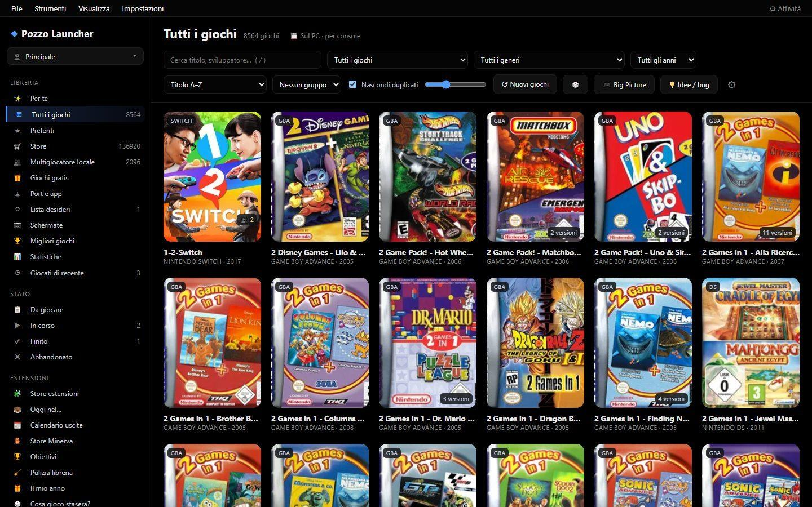
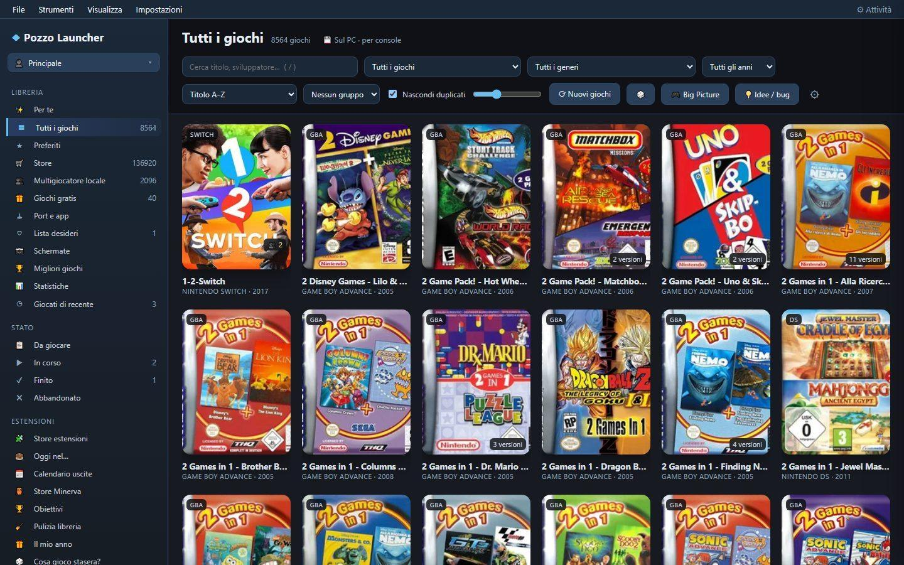
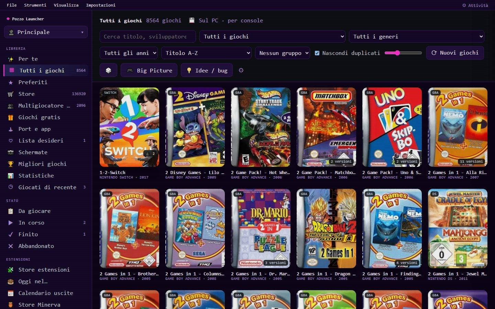
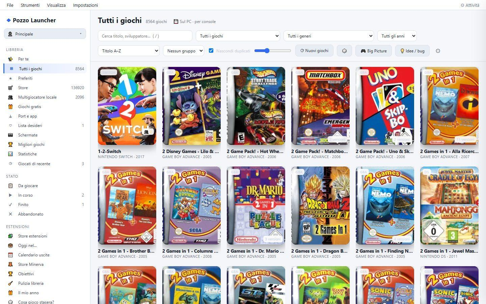
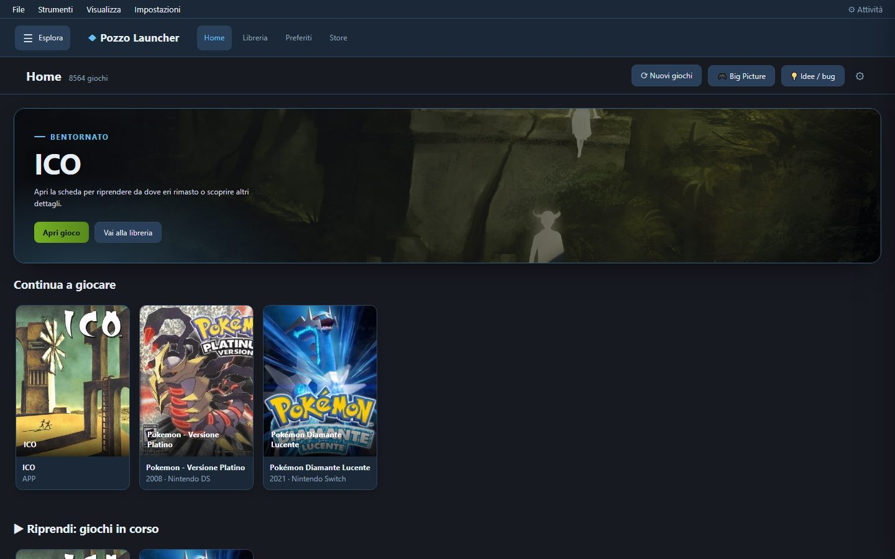
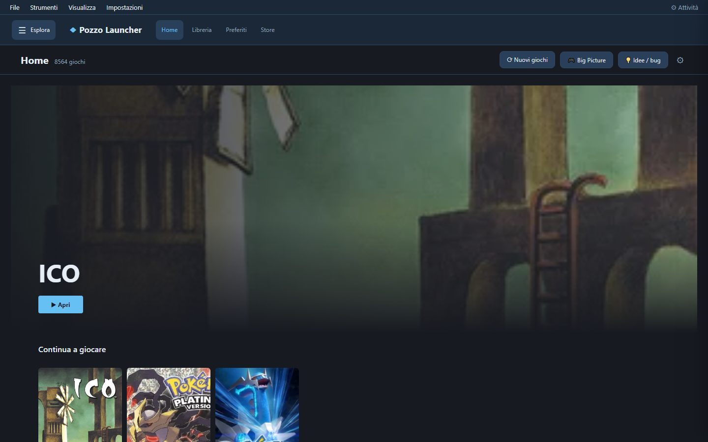
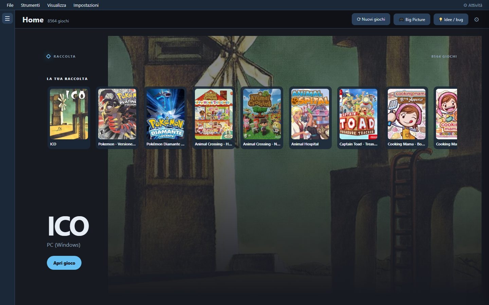
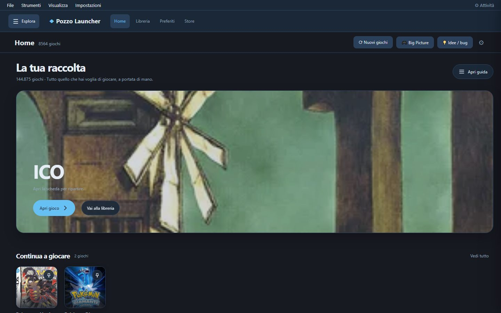
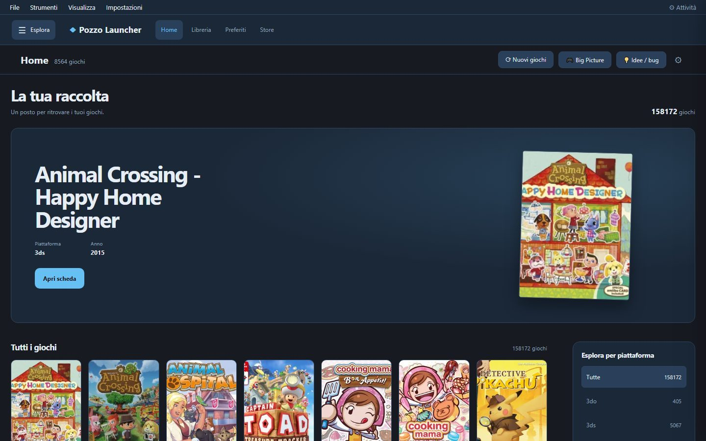
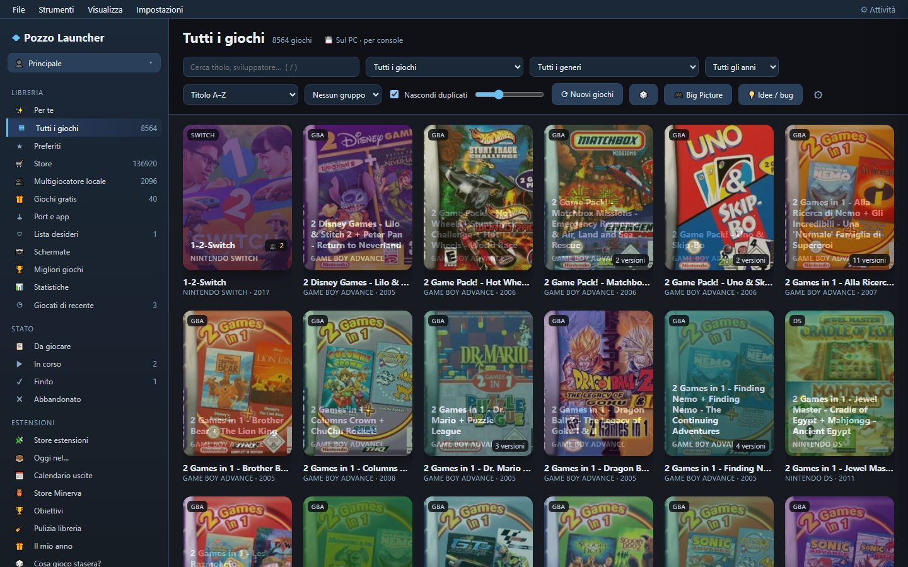

# Pozzo Launcher Themes and Plugins

Pozzo Launcher can be customized in three ways:

| | Target Audience | What It Changes | Language |
|---|---|---|---|
| **Theme** | Anyone | Interface colors | CSS only |
| **Experience Profile** | Users wanting to customize desktop UI | Layout, navigation, Home view, and game detail presentation | JavaScript |
| **Plugin** | Developers | New features: buttons, views, stores, metadata sources, event hooks | JavaScript and/or Python |

Folders are located next to `config.toml`:

```
PozzoLauncher/
  config.toml
  themes/<theme-id>/
  plugins/<plugin-id>/
```

Themes and plugins are activated in **Settings › Appearance**. After adding or enabling a plugin, restart the app.

---

<a id="temi"></a>
## Themes

```
themes/my-theme/
  theme.json
  theme.css          # normal view
  bigpicture.css     # optional: Big Picture mode (if omitted, falls back to "desktop")
```

**theme.json**
```json
{
  "name": "My Theme",
  "description": "Dark green",
  "author": "Me",
  "preview": "#0f1f14",
  "desktop": "theme.css",
  "bigpicture": "bigpicture.css"
}
```

**theme.css**: override color variables to keep the theme compatible with all experience profiles.
```css
:root {
  --bg: #0b140e;        /* background */
  --bg-2: #102016;      /* sidebar, input fields */
  --bg-3: #183024;      /* elevated elements */
  --panel: #0f1d14;     /* detail panel, modals */
  --line: #24442f;      /* borders */
  --text: #e9f5ec;
  --muted: #8fb39a;
  --accent: #3ddc84;    /* primary accent (selection, buttons) */
  --accent-2: #00b894;  /* gradient secondary accent */
  --fav: #ffd54a;
}
```

A theme can technically include arbitrary CSS rules. To keep it decoupled from a specific experience, limit themes to color variables and use an experience profile to alter layout or structure; CSS rules targeting `.tile`, `#sidebar`, or `.detail` can override the appearance dictated by the experience profile.

Two helpful attributes are available on the root page:

| Attribute | Values |
|---|---|
| `<html data-mode>` | `desktop` / `bigpicture` |
| `<html data-theme>` | active theme ID |

The included themes (`pozzo/app/themes/`: OLED, Light, Retro, Night Blue) serve as great reference examples.

In **Settings › Appearance**, you can select your active theme and view color swatches for each:


### Gallery of the 4 Built-in Themes

Here is how Pozzo Launcher looks with the four built-in themes:

#### 1. OLED Theme (True Black)
Pure black background (`#000000`), maximum contrast, perfect for OLED displays and reducing eye fatigue during late-night sessions.



#### 2. Night Blue Theme
Calming indigo and midnight blue shades with cyan accents, ideal for everyday evening use on any monitor.



#### 3. Retro Theme
Warm and nostalgic, featuring cream, brown, and orange tones inspired by 80s and 90s vintage hardware and arcade cabinets.



#### 4. Light Theme
Clean and modern look with a bright background and dark typography, ensuring optimal legibility in brightly lit rooms or offices.



---

## Experience Profiles

Themes and experience profiles are distinct preferences: themes control visual styling (CSS),
whereas experience profiles define behavior and layout for the **desktop** interface.
They are configured separately in **Settings › Appearance** and can be combined freely.
Changing a theme does not alter the experience profile, and vice versa. Themes also apply to Big Picture;
the experience profile contract documented here applies exclusively to the desktop interface.

Built-in experience profiles are located at:

```
pozzo/app/static/experiences/<id>/
  experience.js      # required to register the profile
  style.css          # optional: additional stylesheet for this profile
```

The engine scans subdirectories under `pozzo/app/static/experiences/` using a lowercase ID
(starting with a letter, followed by letters, numbers, `_`, or `-`); paths resolving outside
that directory are rejected. Profiles only require `experience.js` and, optionally, `style.css`.
This is not a plugin packaging format: third-party experiences cannot be installed via the Extensions Store.
Adding a new profile requires bundling its files directly into the distributed application. Loaded
JavaScript runs as trusted app code, not in a sandboxed third-party iframe.

`experience.js` is a JavaScript module that registers the profile using `GS.registerExperience(...)`;
no default export is required:

```js
GS.registerExperience({
  id: "my-experience",             // must match the folder name
  name: "My Experience",           // required
  description: "A simple Home view.",
  nav: "sidebar",                  // "sidebar", "top", or "none"
  detail: "panel",                 // "panel", "page", or "modal"
  home: (element) => { element.textContent = "My Home"; },
  card: null,
  onFocus: (game) => console.log("Focused card:", game.title),
});
```

Supported fields and callbacks:

| Field | Contract |
|---|---|
| `id` | Required; format `[a-z][a-z0-9_-]*` and must match the loaded directory ID. |
| `name` | Required, string. `description` is optional; defaults to empty string if omitted. |
| `nav` | Required: `sidebar` preserves the navigation sidebar; `top` displays a top navigation bar with Home, Library, Favorites, and Store links, plus a toggle for the side drawer; `none` hides both the profile bar and sidebar. Navigation items are not customizable by the profile. |
| `detail` | Required: `panel` renders game details in the side panel; `page` displays details full-screen and shifts focus to the detail view; `modal` renders as a centered dialog overlay with role `dialog` and `aria-modal="true"`, focusing the close button. `panel` does not receive a dedicated ARIA role. These are display modes for existing game details, not custom renderers. |
| `home(element, context)` | Optional; invoked to render the Home view into the DOM node. `context` provides `renderShelvesHome`, `state` (UI state), and `setView`. Invoked synchronously: the engine does not await returned Promises. If a profile declares `home`, it is selected as the default startup view when no prior view is saved and when chosen in the picker. If this callback throws an exception, Home displays an error banner and the exception is logged to the console. |
| `card(game, markup, context)` | Optional; invoked synchronously for each game tile, receiving game data, default HTML markup, and `{ experience, state }`. Returning a string replaces the HTML markup; returning an `Element` replaces the tile's children; returning other values leaves the card unchanged. Exceptions are logged to console and standard tiles remain rendered. |
| `onFocus(game)` | Optional; called whenever focus moves to a game card, receiving the associated game object. Not a window focus event; can be used, for example, to update hero banner content. Exceptions are logged to console. |

The engine validates required fields, `nav`/`detail` values, callback types, and ID matches. If a script fails to register the expected profile or throws an error, the picker disables it and displays the error. If present, `style.css` is only loaded when its corresponding experience is active; arbitrary assets are not exposed via experience routing. There are no callbacks to define arbitrary custom navigation bars or new detail view types.

Built-in experience profiles:

| Experience | Layout & Navigation | Game Detail Presentation |
|---|---|---|
| **Original** (`original`) | Legacy original interface, sidebar. | Side panel. |
| **Catalog** (`catalog`) | Classic catalog view, sidebar. | Side panel. |
| **Shelves** (`shelves`) | Home with recommendations and horizontal shelves; top navigation and side drawer. | Side panel. |
| **Console** (`console`) | Immersive fullscreen view without general navigation; navigating cards updates hero game. | Fullscreen. |
| **Dashboard** (`dashboard`) | Dashboard Home with featured hero game, recent/favorites/collection rows, and quick tips; top navigation. | Side panel. |
| **Cinema** (`cinema`) | Cinematic Home with hero banners and horizontal game rows; top navigation. | Modal overlay. |
| **Storefront** (`storefront`) | Storefront Home with featured spotlight, curated collections, and platform chips; top navigation. | Fullscreen. |

### Visual Gallery of the 6 Experience Profiles

Each experience profile transforms the layout and organization of your launcher:

#### Shelves (`shelves`)
Modern streaming-inspired Home with horizontal thematic rows to quickly resume play, explore franchises, and pick up where you left off.



#### Cinema (`cinema`)
High-impact visual experience featuring full-bleed banners, cinematic backdrops, and modal overlay detail sheets.



#### Console (`console`)
Clean and minimal full-screen interface, optimized for navigating with a controller or mouse as if on a living room gaming console.



#### Dashboard (`dashboard`)
Complete overview featuring a spotlight game, recent sessions, favorites, stats, and quick-launch shortcuts at a glance.



#### Storefront (`storefront`)
Elegant layout highlighting large box art for flagship titles, with quick platform filters and full-screen detail views.



#### Catalog (`catalog`)
The classic view for collectors: a dense grid of box art with a pinned sidebar providing instant access to all consoles and collections.



The selector presents schematic diagrams rather than live screenshots: distinct illustrations are provided for **Console**, **Dashboard**, **Cinema**, **Storefront**, **Original**, **Catalog**, and **Shelves**. **Original** is the legacy preset retaining historical Catalog CSS selectors; it remains a distinct option in the selector. Schematics depict structural arrangement and do not represent exact runtime rendering. Themes remain independently selectable in their own settings section with live color swatches.

Your selected experience profile is saved globally in `settings.json` (`app.experience`) per installation rather than per user profile; an unavailable ID automatically falls back to **Catalog**. Theme preferences are stored separately (`app.theme`). **Shelves** illustrates a custom Home layout with recommendations and horizontal shelves; **Catalog** and **Original** keep traditional sidebar navigation.

Avoid using official platform brand names, logos, or copyrighted artwork when designing themes and profiles.

---

## Plugins

```
plugins/my-plugin/
  plugin.toml      # required
  frontend.js      # optional: UI logic
  style.css        # optional: styles
  backend.py       # optional: Python server backend
```

**plugin.toml**
```toml
[plugin]
name = "My Plugin"
version = "1.0"
author = "Me"
description = "What it does"
api = 1
```

Optional keys in `[plugin]`:

- `permissions = [...]`: permissions requested by the extension, formatted as strings from an established set (with optional `:detail` suffixes):
  `"network:<host>"` (access to an external host, e.g., `"network:api.rawg.io"`), `"network:*"` (any user-specified site, e.g.,
  custom RSS feeds or URLs), `"library:read"`, `"library:write"`,
  `"file:read"`, `"file:write"`, `"settings"`, `"notifications"`, `"launch"` (can launch games or external processes).
  The Extensions Store displays these before installation (disk writes, file operations, program launches, and `network:*` highlighted as sensitive);
  updates prompt only for permissions newly introduced beyond the currently installed version (`installed_permissions`).
  Unrecognized permissions are retained but flagged;
  if this key is omitted entirely, the store warns that permissions are undeclared (`permissions_unknown`).

### Frontend (frontend.js)

A JavaScript module exporting a default initialization function. It receives `gs`, the core client API, which works identically in standard desktop view and Big Picture:

```js
export default function (gs, ctx) {
  // button in each game's detail view
  gs.addGameAction({
    id: "wiki", label: "Wiki", icon: "📖",
    when: (game) => !game.store,          // optional: filter for specific games
    run: (game) => gs.api("/api/open", { body: { url: "https://en.wikipedia.org/wiki/" + encodeURIComponent(game.title) } }),
  });

  // section in game detail view (HTML or DOM Element, supports async)
  gs.addDetailSection({ id: "notes", title: "My Notes", render: async (game) => `<p>${gs.esc(game.title)}</p>` });

  // badge on box art tiles
  gs.addTileBadge({ id: "retro", render: (g) => (g.year && g.year < 1990 ? "RETRO" : null) });

  // sidebar navigation entry that renders a custom view
  gs.addSidebarItem({ id: "my-page", label: "My Page", icon: "✨", view: "my-page" });
  gs.registerView("my-page", { title: "My Page", render: (el) => { el.innerHTML = "<h2>Hello!</h2>"; } });

  // sub-tab in settings, placed under "Streaming"
  gs.addSettingsTab({ id: "my-tab", label: "My Plugin", category: "streaming",
    render: (el) => { el.innerHTML = "…"; } });

  // UI event listeners
  gs.on("gameOpened", (game) => console.log("opened", game.title));
}
```

`category` is optional. If omitted, settings tabs appear under **Extensions**. Available values are
`general`, `appearance`, `library`, `sources`, `stores`, `emulators`, `controllers`, `streaming`, `integrations`,
`extensions`, `data`, and `system`. Categories can be linked directly using URLs such as `#settings/streaming`.

**UI Events**:
- `libraryLoaded`: library loaded or reloaded;
- `viewChanged`: view navigation occurred;
- `gameOpened`: game detail sheet opened;
- `uiChanged`: a plugin injected or mutated UI elements;
- `extensionsLoaded`: themes and plugins successfully loaded.

**Utility Functions**:

| Function | Description |
|---|---|
| `gs.api(path, {body, method})` | Calls application API endpoints or your plugin's backend |
| `gs.library()` | In-memory library state (`games`, `plats`, `colls`, …) |
| `gs.openGame(id)` | Opens the detail view for a specific game |
| `gs.currentGame()` | Returns the currently open game object |
| `gs.toast(msg, isError)` | Displays a transient toast notification |
| `gs.esc(text)` | Escapes untrusted text safely for HTML insertion |
| `gs.mode` | `"desktop"` or `"bigpicture"` |

`ctx.settings` contains configuration saved by the plugin backend.

### Server (backend.py)

```python
def register(gs):
    # endpoint: GET /plugin-api/<plugin-id>/hello
    @gs.route("hello")
    def hello():
        return {"message": "hello", "settings": gs.settings}

    # events: game_started, game_stopped, library_built, scrape_finished, stores_refreshed
    gs.on("game_stopped", lambda info: gs.log(f"{info['title']}: {info.get('played', 0):.0f} seconds"))

    # persistent settings (persisted in settings.json)
    gs.save_settings({"last_run": "today"})
```

`gs` provides the following server APIs:

| Member | Description |
|---|---|
| `gs.route(path, methods=("GET",))` | Exposes a route under `/plugin-api/<id>/<path>` (FastAPI) |
| `gs.add_store(StoreClass)` | Registers a **library provider**, i.e. a new game store: subclass of `pozzo.stores.base.StoreProvider`, implementing `fetch()` returning `StoreGame` instances (installed or available, with `launch` and `install_uri`) |
| `gs.add_source(SourceClass)` | Registers a **metadata scraping source**: subclass of `pozzo.sources.base.Source`, implementing `lookup(game)` |
| `gs.on(event, handler)` | Subscribes to server-side lifecycle events |
| `gs.job(name, func, every=seconds, run_at_start=False)` | Registers a periodic task: runs `func()` every `every` seconds on a daemon worker thread (see below) |
| `gs.cfg` | Application configuration (read-only) |
| `gs.settings`, `gs.save_settings(dict)` | Plugin configuration store |
| `gs.log(msg)` | Logs a message to launcher logs |

#### Periodic Background Jobs (`gs.job`)

```python
def register(gs):
    def check():
        ...  # e.g., fetch a remote feed, refresh a cache

    gs.job("feed-checker", check, every=3600, run_at_start=True)
```

- `func` receives no arguments and executes on a background daemon thread without blocking application startup.
- With `run_at_start=True`, the first execution runs immediately; otherwise, it waits for `every` seconds (`every` must be > 0).
- Exceptions thrown within `func` are logged (`Plugin <id>, job <name>: ...`) and execution resumes automatically on the next cycle.
- Jobs terminate on application exit. `gs.job` returns the underlying job object; calling `.stop()` halts it prematurely.
- In the plugin status endpoint (`GET /api/extensions`, `plugins` list), each plugin reports `load_ms` (time elapsed in `register()`) and `jobs` (name, interval, run count, last error).

#### Lazy Loading (`load = "lazy"`)

By default, plugin backends are imported and `register()` executes synchronously at launcher startup (`load = "eager"`). Specifying `load = "lazy"` in `[plugin]` inside `plugin.toml` causes the app to register a lightweight route placeholder under `/plugin-api/<id>/...`: upon the **first incoming request** to its routes, `backend.py` is imported, `register()` runs once, and the request is forwarded; from then on, it functions identically to an eager plugin. `frontend.js` and `style.css` remain static assets served normally.

- Only use lazy loading if `register()` **exclusively registers routes via `gs.route`**. Lifecycle listeners (`gs.on`), background jobs (`gs.job`), stores (`gs.add_store`), and scrapers (`gs.add_source`) must be active immediately at startup: in a lazy plugin, they will only register after the first API invocation (missing earlier lifecycle events). The launcher logs this and flags `eager_needed`: if flagged, remove `load`.
- If an unhandled error occurs during `import` or `register()` of a lazy plugin, routes return an HTTP 500 status detailing the cause (also reflected in `error`); the rest of the application remains unaffected. The backend is not retried until the app is restarted.
- In `GET /api/extensions`, each plugin reports its `load` mode (`eager`/`lazy`), `first_use_ms` (time spent importing and running `register()` on initial hit, `null` if eager or not yet accessed), and `eager_needed`. For lazy plugins, initial `load_ms` reflects only placeholder registration (~0 ms).

### Full Example

The **Statistics** plugin (`extensions/statistiche/`) demonstrates all facets:
- a backend with an endpoint and event hook;
- a frontend with a custom view, a sidebar entry, and an action button in game details;
- a custom stylesheet.

### Extensions Store

Pozzo Launcher bundles one core plugin: the **Extensions Store** (`pozzo/app/plugins/estensioni/`). It is permanently pinned as the first entry in the sidebar and under **Settings › Appearance**, and cannot be disabled. All other extensions are installed through it into the `plugins/` directory adjacent to `config.toml`. Installations and removals take effect immediately without restarting the application. However, backend hooks such as `gs.on` listeners or `add_store` providers registered by an extension remain in memory until the next restart: if an element does not appear or disappear as expected, restart the app.

Extensions are retrieved from configured **Sources**, listed under *Extension Sources* at the top of the page:

- the first entry is always the **official store** ([the `extensions/` directory of the application repository](https://github.com/erpaffo/Pozzo-Launcher/tree/main/extensions)) and cannot be removed;
- **Add Source** accepts either a GitHub repository URL (`https://github.com/user/repo`, including `/tree/<tag>`) or a direct HTTPS URL pointing to an `index.json`. If pointing to a single extension repository, that extension is added; if pointing to an external store index, its complete catalog is registered. The app validates that the URL is reachable and serves valid extensions;
- if the same extension ID exists across multiple sources, the official store takes precedence; extensions originating from third-party sources are annotated as "from user/repo".

Each extension maintains its own `index.json` cataloging files and their SHA-256 hashes. In the Extensions Store, each extension card displays a **graphical preview (screenshot)**, detailed summary, and badges highlighting key capabilities.
Clicking a card (or the **ℹ️ Details** button) opens an **in-depth modal sheet** detailing:
- extension version, author, and minimum required Pozzo Launcher version;
- high-resolution screenshot demonstrating the plugin active within the interface;
- complete explanation of the extension's features and purpose;
- a **"How it works and where to find it"** section providing step-by-step instructions showing exactly where new menu items, buttons, or settings are located;
- a bulleted breakdown of technical specifications: included files, repository origin, and **declared permissions**
  (such as network access or library read access), highlighting sensitive privileges (disk writes, file filesystem access, executable launching). Extensions omitting permission declarations are explicitly flagged.

Before installation, the app presents requested permissions and asks for confirmation. During updates, confirmation is requested only if the new version introduces permissions not previously granted (when the app knows the installed version). Cards display the total count of requested permissions.

From the details sheet, you can directly install, update, or uninstall the extension. Installation downloads files sequentially and only writes to disk if **all** cryptographic hashes match. File names containing path traversal characters, nested subdirectories, and versions requiring higher `min_app` than the running app are rejected. While SHA-256 validation guarantees file integrity against the remote index, it does not certify third-party code safety: third-party extensions execute code on your PC, so only add trusted sources.
An extension linked to a local development directory (see below) is never updated or deleted by the store.

To test an alternative store index in place of the official store (including local disk files prior to pushing), configure `settings.json`:
`"app": {"extensions_index": "C:/path/to/store/index.json"}`.


### Publishing an Extension

Each extension resides in its **own repository** (for example, `pozzo-ext-stasera`): the root directory contains `plugin.toml`, extension source files (no subfolders), and `index.json`. The official store is hosted in a repository containing an `index.json` that references participating repositories and their approved release tags:

```json
{"version": 1, "repos": [{"repo": "erpaffo/gamescraper-ext-stasera", "ref": "v1.0"}]}
```

The app fetches each repository's `index.json` corresponding to that specific tag. An index entry can also specify `"url"` instead of `"repo"`/`"ref"` for repositories hosted outside GitHub.

To publish a release:

1. In `plugin.toml`, increment `version` and update `min_app = "x.y.z"` if utilizing newly introduced application features.
2. Regenerate the local index: `python <Pozzo Launcher>/tools/extensions.py index .`
3. Commit changes, tag `v<version>`, and push to remote.
4. In the store repository, update `ref` to the new tag (via a pull request). Users who added the individual extension repository directly as a source receive updates immediately, as that source follows the main branch.

Repositories must use LF line endings (`.gitattributes`): file SHA-256 hashes in `index.json` match file contents as served raw by GitHub.

**Exporting from main repo to standalone repositories**: `python tools/extensions.py export <target_dir> <user>` creates standalone repositories ready for publishing in `<target_dir>` for every extension in `extensions/` (including source files, `index.json`, README, and license), along with the store index repository pointing to `<user>/pozzo-ext-<id>` at tag `v<version>`.

To test an extension locally in your launcher, `python tools/extensions.py install [<path>]` **copies** it into your active `plugins/` directory: running without arguments installs all extensions from `extensions/`; providing a path installs from cloned repositories or a single extension folder. Re-run after editing source files and restart the app. Do not use filesystem links (junctions or symlinks): launcher packages cannot traverse links resolving into OneDrive folders and will fail to boot (WinError 448). Official release bundles contain only the core store plugin.

### Available Extensions

| Plugin | What It Does |
|---|---|
| **Statistics** | Play time per console and store, most played titles, metadata completeness tracker |
| **Link → Store** | Scrapes index pages collecting external links, groups URLs by header tags (h2/h3), and adds each as a console store or direct PC download/repack store |
| **Store Minerva + Switch** | One-click import for minerva-archive.org directories listed on r-roms.github.io **and** adds preset Switch stores (NXBrew `game-index`, Ziperto NSP, Ziperto XCI) |
| **What Should I Play Tonight?** | Recommends a backlog game tailored to your available time (using HowLongToBeat durations), preferred genre, and console, prioritizing titles you haven't played in a while; includes "Roll another" and "Play" |
| **Retro Anniversaries** | Adds a "30 YEARS" badge to covers of games released on today's date in history and introduces an "On This Day in..." page (requires complete release date metadata) |
| **Library Cleanup** | Detects duplicates, unplayed titles, neglected games, and incomplete metadata; provides bulk management (hide, abandoned, backlog), "DUP" badges, and **🧹 Remove manual duplicates** (items added manually sharing identical executables and arguments, retaining the oldest entry) |
| **Gaming Journal** | Adds dated session logs and playthrough notes directly inside each game's detail view (alongside existing personal notes) |
| **Time Limit** | Triggers notifications when exceeding X daily or weekly gaming hours (for the active user profile); provides advisory alerts without terminating games |
| **Personal Goals** | Periodic challenges (completed games, hours played, days active), daily gameplay streaks, and achievement badges |
| **Year in Review** | Summarizes your gaming year (hours, top played titles, consoles, monthly breakdown) with an exportable shareable graphic |
| **SteamGridDB** | Fetches vertical grid covers, hero backgrounds, and missing logos; requires a free API key under Settings › SteamGridDB. Also powers the **🖼 Game artwork…** context menu option (pick custom artwork per game) |
| **Release Calendar** | Upcoming releases for wishlisted titles and anticipated games across your favorite genres, powered by RAWG (uses key configured in Settings › Sources) |
| **Gaming News** | Aggregated RSS/Atom feeds from major publishers (PlayStation, Xbox, Nintendo, Steam, Capcom…) and gaming outlets, featuring a "My games & consoles only" filter, tag classification (announcement, patch, DLC, release), Monday weekly recap, and a "Follow" button in game details |
| **Can My PC Run It?** | Analyzes system CPU, GPU, and RAM to deliver an instant compatibility verdict (Runs great, Tweaks needed, Too demanding), comparing against Steam hardware requirements and recommending emulator configurations |
| **Reviews and Scores** | Aggregates critic and community review scores in each game's detail view: Metacritic, OpenCritic (with recommendation tier and percentage), and Steam user reviews |
| **Deals and Bundles** | Real-time price tracking for wishlisted games (with "Historical Low" badges), active IsThereAnyDeal bundles tagged "For you" when including tracked or owned games, and currently claimable free games |
| **Local Media** | Movies, TV series, and music from local PC folders browsable as a dedicated media library: title recognition, local artwork support (poster.jpg, folder.jpg), playback resume, and support for internal or external media players |
| **Web Recipes** | Movies and podcast catalogs from legitimate public web directories and feeds (e.g., Internet Archive and NASA podcasts) extracted via declarative TOML recipes without executable code; features ETag caching, robots.txt compliance, metadata details, episodes, and direct playback |

**Store Minerva + Switch** stores its presets in `PRESETS` (`backend.py`): adding additional repositories requires only a single line
(`{"console": ["https://…"]}`). Because listings for a console may use different layout formats
(`type_b`, `type_c`, `type_d`), when a console has multiple URLs, the hardcoded `type` is omitted:
each page structure is detected automatically by `catalog.detect_kind`.

**Link → Store** serves as an example of a plugin that **writes to settings**: it invokes internal configuration helpers
(`config.set_setting`), applying changes immediately without restarting the application.
Page parsing logic resides in `pozzo/linklist.py` (`scan_page`, `add_store`), external to the
plugin codebase, allowing automated unit testing without spinning up a live server.

**Local Media** and **Web Recipes** are extensions for **Pozzo Media** (`api = 2`): they operate using their own isolated cache separate from the game library. **Local Media** requires the `media:read` permission to scan only folders explicitly designated by the user. **Web Recipes** processes declarative specifications for HTML pages, RSS podcasts, and JSON APIs, safeguarding system security by strictly forbidding executable code and restricting network operations to whitelisted hosts.

In the Media view, the **Sources** panel consolidates local folders, Jellyfin/Plex servers (username/password or authentication token), Kodi/Stream4me endpoints, Web Recipes (with "Refresh Catalog"), and metadata scrapers into a unified interface. Global search queries all configured sources concurrently with a 2-second timeout per source: search results stream in asynchronously, titles present across multiple sources merge into a single card with source badges, and status chips indicate source responsiveness. Catalogs from Web Recipes/Stream4me are served from local paged caches and refresh in the background or on demand via "Refresh Catalog". Feature validated via automated tests, recommended for manual verification within the launcher interface.

### Security

A plugin containing `backend.py` runs with full application privileges: it can read and write files and launch system processes. Only install plugins from trusted sources whose code you have reviewed.
