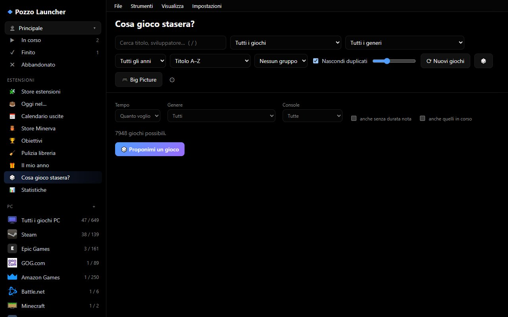

# Guide and Introduction

Pozzo Launcher is a universal video game library for your PC: it brings together the **console ROMs** on your storage and the **PC games** from all your stores (Steam, Epic Games, GOG, Riot Games, Battle.net, Amazon, Xbox, and Minecraft) into a single, elegant, and blazing-fast interface. It automatically enriches them with high-resolution box art, descriptions, critic ratings, and playtimes, and launches them with a single click.


> The manual is also available as a complete PDF: [PozzoLauncher-manuale.pdf](../PozzoLauncher-manuale.pdf), identical to the website but formatted for printing or offline reading. It is also included among the release attachments of every version on GitHub.

---

## What do you want to do today? (Guided paths with preview)

Select the goal you want to achieve to view the corresponding screen and step-by-step guide immediately:

### 1. Explore my collection and launch a game right away
Looking for an instantaneous interface that stays smooth even with hundreds of thousands of games, featuring real-time search, console filters, and detailed cards complete with scores and screenshots?

[](libreria.md)

👉 **What to do:** Head to the [The Library](libreria.md) chapter to find out how to organize views, sort by rating or duration, and customize covers.

---

### 2. I don't know what to play tonight!
Short on time, playing with friends, or looking for smart recommendations based on games you've loved?

[](libreria.md#per-te-e-a-cosa-vuoi-giocare)

👉 **What to do:** Open the **✨ For You** view in the sidebar or click **🎲 What do you want to play?**: the app will ask 3 quick questions (available time, players, genre) and immediately suggest the best ready-to-launch games! Read the [For You and recommendations](libreria.md#per-te-e-a-cosa-vuoi-giocare) guide.

---

### 3. Use your phone as a remote, controller, or touchscreen for DS and 3DS
Want to control your PC from the couch, use your smartphone as a gamepad with gyroscope for Mario Kart, or as a touchscreen for Nintendo DS and 3DS?

[](telefono-streaming.md)

👉 **What to do:** Go to [Phone and streaming](telefono-streaming.md): it takes just 30 seconds to scan the QR code—no store app installs required, secured by a local certificate.

---

### 4. Play on your TV from the couch (Big Picture Mode)
Connected your PC to your living room TV and want to browse your library exclusively using a controller without touching a mouse or keyboard?

[](bigpicture.md)

👉 **What to do:** Press `F11` to enter [Big Picture](bigpicture.md): a 10-foot interface with sound effects, D-pad navigation, and a customizable home screen.

---

### 5. Change theme and customize visual experience
Do you prefer a dark theme for OLED monitors, an 80s retro aesthetic, or a horizontal Netflix-style shelves layout?

[](ESTENSIONI.md)

👉 **What to do:** Check out the [Themes and experience profiles](ESTENSIONI.md) guide to see previews of the 4 included themes (OLED, Night Blue, Retro, Light) and 6 desktop profiles (Shelves, Cinema, Console, Dashboard, Showcase, Catalog).

---

### 6. Free games of the week, wishlist, and PC ports
Want to claim weekly free games from Epic, Steam, GOG, and Prime Gaming, or install native PC recompilations of console masterpieces?

[](extra.md)

👉 **What to do:** Read the [Free games, wishlist, and PC ports](extra.md) section to learn how to track historical low prices and play PC ports with enhanced graphics.

---

### 7. Have a question or something isn't working?
Have questions about launching an emulator, syncing saves between two PCs, or troubleshooting a network error?

[](assistenza.md)

👉 **What to do:** Visit our new [Help Center and Frequently Asked Questions (FAQ)](assistenza.md) (Google Help style) to find instant answers and guided solutions for all common issues!

---

### 8. Manage downloads with a unified queue, Torrent, and Debrid services
Want to download your games with parallel-segment acceleration, handle torrent files or unrestrict links via Real-Debrid, and automatically extract archives into the right folders?

👉 **What to do:** Open the **⬇ Downloads** view in the sidebar and refer to the [Integrated Download Manager](store-online.md#gestore-dei-download-integrato-coda-torrent-e-debrid) guide to explore queue options, Game Mode, and automated extraction for Nintendo Switch.

---

### 9. Play online with a friend (RetroArch Netplay & Eden Switch)
Want to challenge a friend remotely to arcade/console classics on RetroArch or host a private local/wireless room on Nintendo Switch with Eden?

👉 **What to do:** Go to the [Play with a friend](giocare.md#partita-con-un-amico) section: generate an invite code with one click, send it to your friend, and jump right into a match over local network, internet, or free VPN.

---

## Feature Overview

| Area | Overview | Learn more |
|---|---|---|
| **Library** | Box art grid with instant search, filters, automatic and custom collections, recommendations | [The Library](libreria.md) |
| **ROMs & Metadata** | Recognizes console folders, identifies games offline, and downloads data and images from multiple sources | [ROMs and data scraping](rom-e-scraping.md) |
| **Gaming** | Launches each game with the proper emulator, records session playtime, backs up saves, fast SSD scratch disk | [Gaming](giocare.md) |
| **Download Manager** | Unified queue with multi-segment HTTP, Torrent, and Debrid (Real-Debrid, etc.) with automatic extraction | [Adding stores and downloads](store-online.md#gestore-dei-download-integrato-coda-torrent-e-debrid) |
| **Multiplayer / Netplay** | Play remotely with a friend on RetroArch or Eden Switch via invite code without dedicated servers | [Playing with a friend](giocare.md#partita-con-un-amico) |
| **PC Games** | Installed and owned games from Steam, Epic, GOG, Riot, Battle.net, Amazon, Xbox | [PC games from stores](store-pc.md) |
| **Online Stores** | Game catalogs available to download for consoles and PC, fetched from websites and web archives | [Adding stores](store-online.md) |
| **Extras** | Weekly free games, wishlist with key price tracking, PC ports of console classics | [Free games, wishlist, PC ports](extra.md) |
| **Phone** | Phone as a remote, controller (up to 4 players), and DS/3DS touch dual-screen | [Phone and streaming](telefono-streaming.md) |
| **TV** | Native full-screen interface built for controllers and 4K displays | [Big Picture](bigpicture.md) |
| **Customization** | 4 color themes, 6 desktop experience profiles, and extension/plugin store | [Themes and plugins](ESTENSIONI.md) |
| **Multi-PC & Family** | Data sync between two PCs via LAN/shared folder and separated user profiles | [Data and maintenance](manutenzione.md#sincronizzazione-tra-pc), [Profiles](libreria.md#profili-utente) |
| **Integrations** | Discord Rich Presence (including 1 of 2 netplay), Windows notifications, web library export | [Gaming](giocare.md#mostrare-su-discord-cosa-stai-giocando), [Notifications](extra.md#avvisi-di-windows) |
| **Help & FAQ** | Step-by-step troubleshooting, Health self-diagnostics, frequently asked questions | [Help Center and FAQ](assistenza.md) |

---

## Webhooks

Settings › General › **Webhooks**: Pozzo can send a JSON `POST` request to an address of your choice when one of these events occurs: `gioco_avviato`, `gioco_chiuso`, `download_finito`, `prezzo_sceso`. Each webhook includes an `http://` or `https://` URL, the events to send, an optional secret, and a **Test** button to verify it. You can configure up to 20 webhooks.

Example payload sent (`event` is one of the four event names above, `time` is in UTC, `data` varies depending on the event):

```json
{"event": "gioco_avviato", "time": "2026-11-04T20:30:00+00:00", "data": {"...": "game status, varies by event"}}
```

If you configure a secret, each request includes the `X-Pozzo-Signature: sha256=<HMAC-SHA256 of body>` header to verify it originated from Pozzo.

Home Assistant Example: create an automation with a **Webhook** trigger (ID, for example `pozzo-gioco`), then in Pozzo's webhook settings use `http://HOME-ASSISTANT-IP:8123/api/webhook/pozzo-gioco` as the URL and select only the events you need. Home Assistant webhooks do not require a secret.

---

## Architecture and Security

Pozzo Launcher consists of a **lightweight local server** (Python, FastAPI) communicating with a web interface displayed in a native system window.
- The local server responds exclusively on the PC on which it is running (`127.0.0.1`).
- The port is chosen randomly on startup and secured with a secret token generated on your PC.
- The code is completely open source and auditable.
