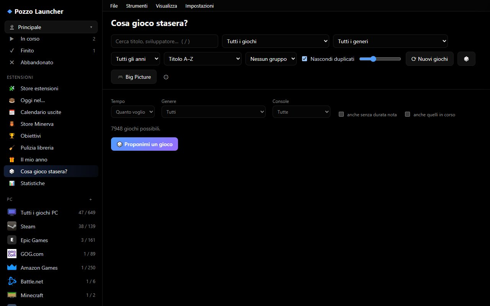

# The Library

The main window is divided into three sections: the **sidebar** on the left (views, consoles, stores, collections), the **toolbar** at the top (search, sorting, filters), and the box art **grid**. Clicking a cover opens the game's **detail** pane on the right.

The library is loaded into the application all at once: search, filters, and sorting are calculated entirely in memory and remain instantaneous even with tens of thousands of games. In the grid, only currently visible covers are kept in the DOM, served as lightweight WebP thumbnails.

## Sidebar Views

| View | What it shows |
|---|---|
| **✨ For You** | Netflix-style recommendation page (see [For You](#per-te-e-a-cosa-vuoi-giocare)) |
| **▦ All Games** | The entire library: ROMs and PC games |
| **★ Favorites** | Games marked with a star; under this item, a **sub-item for each console** containing favorites for that console (only consoles that have favorites appear) |
| **🛒 Stores** | Games to install or download: games owned in stores but not installed, and games from online stores |
| **👥 Local Multiplayer** | Games supporting at least 2 players on the same screen |
| **🎁 Free Games** | Current free offers and giveaways (see [Free Games](extra.md#giochi-gratis)) |
| **🕹 Ports & Apps** | Console games recompiled natively for PC and games/emulators from GitHub releases (see [Ports & Apps](extra.md#port-e-app)) |
| **♡ Wishlist** | Games you want to buy, with price tracking and alerts (see [Wishlist](extra.md#lista-desideri)) |
| **📷 Screenshots** | Screenshots captured during your play sessions |
| **🏆 Top Games** | Top 100 and Top 1000 leaderboards (see [Top Games](#migliori-giochi)) |
| **📊 Statistics** | Playtime by console and store, most played games, data completeness |
| **◷ Recently Played** | Sorted by last played session |
| **🧩 Applications** | Programs manually added as an *Application* rather than a game (only appears if any exist) |
| **? Without Data** | Games for which no information was found across any source |
| **⧉ Duplicates** | Secondary versions of games (different regions, revisions) |
| **⊘ Hidden** | Games you have hidden |

Under the views, you will find **consoles** (with their game count), the **PC** section with individual stores, **collections**, and **smart collections**. Game play statuses (Backlog / To Play, Playing, Finished, Abandoned) also act as views.

Each sidebar item is a filter applied to the same unified grid: for instance, **👥 Local Multiplayer** only shows games with at least two players on the same screen, retaining all the same filters and sorting options as *All Games*.

## User Profiles

If multiple people play on the same PC, each can have their own **profile**: the **👤** button at the top of the sidebar displays the active profile and opens the menu to switch profiles, create a new one (**＋ New profile…**), rename, or delete it.

| Separated per profile | Shared across all profiles |
|---|---|
| Favorites, hidden titles, play statuses, notes, and user ratings | The library: ROMs, PC games, online stores, downloaded metadata |
| Playtime, play sessions, *Recently Played* | Emulators, launch profiles |
| Personal collections and collection adjustments | Plugins, smart collections |
| Wishlist and its API keys (IsThereAnyDeal, GG.deals) | Screenshots |
| Spotify account, Discord (presence and voice), RetroAchievements, Epic, GOG, Steam (API key and ID), GitHub token for ports | Global ROM paths and folders, system stores (Battle.net, Amazon, Xbox, Riot) |
| Theme and experience profile (a new profile inherits current settings) | |
| Which games are visible: personal ROM folders, manually added games, games from personal store accounts | |

Each profile has an icon (emoji or short text) and a color, displayed on the 👤 button: they can be changed from the menu under **🎨 Icon, color and PIN…**. The **PIN** (4–8 digits) locks the profile in the menu: switching to it, or changing its appearance and PIN, requires entering the PIN first. The PIN prevents accidentally switching profiles; it does not encrypt files (anyone with access to the data folder can inspect account files). After five incorrect PIN attempts, a 30-second lockout is enforced.

**Where to switch users.** The active user is always displayed at the top right of the menu bar (**👤 name ▾**): clicking it opens the profile menu with **👥 Switch user…**, **＋ New profile…**, and settings for icon, color, and PIN. The same command is available in the **File** menu, in *Settings → General → User profiles* (**👥 Switch user…**), via `Ctrl+P`, and in Big Picture from the **User** tab. This works in all interface layouts, even when the sidebar is hidden.

With two or more profiles, the **"Who's playing?"** screen appears on startup: choose using mouse, arrow keys and Enter, or controller; a PIN-protected profile prompts for the PIN via an on-screen keypad. Checking **"Always sign in with this profile on this device"** prevents the screen from showing again on that device (PC and phone each remember their own selection). To choose on every launch again, uncheck this option in *Settings → General → User profiles* or from the prompt itself; you can also disable "Who's playing?" entirely from there. A PIN-protected profile requires the PIN on each fresh app startup even when remembered. The underlying game library remains unified for everyone.

### One Single Library, Everyone Sees Their Own Games

Metadata, box art, and cache are stored as **a single copy per PC**: if two profiles own the same game, it has only one record and one cover. Only *who sees what* changes: global ROM folders, games installed on the PC, and system stores are shared by everyone; a ROM folder added by a profile (`roms_extra`), games manually added by a profile, and games owned on its linked Steam/Epic/GOG accounts belong to that profile (if two profiles add the same folder or game, both can see it). Games manually added prior to this version remain shared by everyone. Rebuilding the library is required after changing folders or accounts.

Profiles are configured **per device**: the PC and another browser session can run under different profiles (via the `gs_profile` cookie). The phone (`/m/`) pairs using an authentication token rather than the PC cookie: it uses whichever profile was last active on the server until another is chosen. Backups also include the `profiles/*.json` files, which contain account credentials.

The **Main** profile is permanent and cannot be deleted. Deleting another profile does not permanently wipe anything: its database and account file are archived into `cache/profiles/eliminati/` (the active account file resides in the settings directory under `profiles/`). Profiles cannot be switched while a game session is running. With [PC synchronization](manutenzione.md#sincronizzazione-tra-pc), each profile syncs with the profile sharing the **same name** on the other PC.

## Search, Sort, and Group

- **Search** (`/` key): searches title, developer, console, and store. Multiple words must all match; case and accents are ignored.
- **Sorting**: Title A–Z, Year ↑/↓, Console, Recently Played, Playtime, Rating, Size ↑/↓, Length ↑/↓ (HowLongToBeat), Store.
- **Grouping**: None, by Console, by Year, or Alphabetical, with section headers for each group.
- **Installed Filter** (in console and store views): *All*, *Owned / Installed only*, *To download / install only*.
- **Hide Duplicates**: displays a single canonical version per game (enabled by default).
- **Cover Size**: slider located next to the filters.
- **🎲 Random Game**: selects a random game from currently visible entries (taking filters and search into account), prioritizing titles that are ready to launch immediately.

### Saved filters

The **＋** next to "Saved filters" in the sidebar saves the current combination under a name: the view (console, store or status), search, genre, decade, language, installed, sort and grouping. Click an entry to apply it, rename it (✎) or delete it (✕). Saved filters are **per profile**. They also appear in the **Ctrl+K** palette ("Saved filters" group) and as a "Saved filters" dashboard widget.

### Discover

The **Discover** panel filters and sorts the current view to help you find what to play:

| Filter | Criteria |
|---|---|
| 🏆 Critic Favorites | Metacritic (RAWG) or critic rating (IGDB) of at least 75 |
| ❤️ Player Favorites | User rating of at least 75% with at least 20 votes |
| ⭐ Masterpieces | Critic score ≥ 90 or player score ≥ 85% with at least 50 votes |
| 🔥 Most Voted | Sorted by number of player ratings |
| 💎 Hidden Gems | High rating (at least 80%) with few votes (between 5 and 200) |
| 🕹 Timeless Classics | Released before 2000 with rating ≥ 75% |
| 🆕 Released in Last 3 Years | |
| 👥 Local Multiplayer | At least 2 players on the same screen |
| ⏱ Short / 🏔 Long | Main story ≤ 5 hours / ≥ 40 hours (HowLongToBeat) |
| ⏳ Never Played | Zero recorded play sessions |
| 👎 Lowest Rated | Rating under 50% with at least 10 votes |
| ❔ Unrated | |

Can be combined with a **genre** and a **decade**. When a Discover filter dictates sorting order, standard sorting is temporarily disabled.

### Consoles Without Games: "Other consoles"

**All** consoles are shown, even those with no games or stores: these sit in the collapsible **Other consoles** group,
so you can add a store to them too. Adding stores to a console (from the editor, from Minerva or from Link → Store)
populates it immediately, without restarting the application.

## Game Details

The detail pane displays box art, background art, description, developer, publisher, genres, release year, player count, ratings (user and critic), file size, data sources, and missing metadata if applicable. In the modal layout (Cinema), HowLongToBeat playtime estimates are also shown.

Main actions:

- **▶ Play** (or `Enter`, or double-clicking the cover) launches the game. For uninstalled PC games, an **⬇ Install** button appears; for online store games, download buttons for each source are shown.
- **★ Favorite**, **Status** (📋 To Play / Backlog, ▶ Playing, ✔ Finished, ✖ Dropped), **Hide**.
- **Personal note** and **1 to 5 star rating**: applied across all versions of the game.
- **Collections**: add or remove the game from a collection.
- **Versions**: other versions of the same game (regions, revisions, other stores); you can select which one to set as default/primary.
- **⚙ Launch profile** (emulator, arguments, and custom launch scripts for this specific game) and **🖥 Desktop shortcut**: see [Gaming](giocare.md#profilo-di-avvio-di-un-singolo-gioco).
- **Missing: …** with **⟳ Fetch missing data**: re-queries sources specifically for this game and its versions.
- Contextual extra sections depending on the game: saves, RetroAchievements, Switch updates & DLCs, available PC ports. These are detailed in their respective chapters.

### Right-Click Context Menu

Right-clicking any game opens a quick context menu across all views (library, For You, Top, statistics, and Cinema, Console, Dashboard, Showcase, and Shelves layouts): Play, Details, Show in folder, **🖼 Game artwork…**, linked applications, **⬇ Install** and **🛒 Store page** (for store games), **🖥 Create desktop shortcut**, **📋 Copy title**, favorites, add to collection, **star rating** (1–5), status, hide. **Remove from…** removes the game from the current view (for instance from "Recently Played", which only resets the last-played date while keeping recorded playtime and launch count intact) or from other categories to which it belongs.

### Choosing Game Artwork

**🖼 Game artwork…** (from the right-click menu, or **🖼 Artwork** in the game card) displays a slot for each image type: *Cover*, *Background*, *Banner*, *Logo*, *Icon*, *Screenshot*… Beneath each slot, its source is indicated: **from sources** (downloaded during scraping) or **custom chosen**. Selecting an image type allows you to:

- **📁 Upload from PC**: a PNG, JPG, GIF, WebP, or BMP file (up to 25 MB). You can also drag and drop it into the window.
- click on a candidate from **SteamGridDB**, if the extension is enabled and an API key is configured;
- paste an **image URL** (http or https) and click **Use**: the app downloads it. Ensure you provide the direct image URL, not the hosting web page. If the host blocks external downloads, save the image to your PC and upload it;
- **↺ Reset to original**: clears your custom choice and restores the artwork fetched from sources (or none, if unavailable).

This also works for games where online scrapers found no match, such as Hearthstone on Battle.net.

Managed in one central place, your chosen image applies everywhere: grid, detail card, Big Picture, phone remote, and exported web page.

### Video Snaps

Short gameplay clips (from ScreenScraper) play when you hover a cover, in the game details, in Big Picture and in the
screensaver. They are **off by default**: turn them on in **Settings › Appearance** with **Download video snaps**; they
are fetched at the next data collection (30 MB cap per clip, so they use disk space and bandwidth). They respect the
animations setting.

### Clips in the Gallery

The **📷 Screenshots** view also shows the video clips (`.mp4`, `.webm`, `.mkv`) made by Xbox Game Bar, NVIDIA
ShadowPlay and AMD ReLive during the session: they are imported automatically and play from the gallery. The videos are
**not copied**: the gallery uses the original file, so if you move or delete it, it disappears from the gallery too.

### Steam, GOG and Epic Achievements

In the game details, Steam, GOG and Epic achievements appear (progress bar, icons, locked and unlocked, rarity) next to
RetroAchievements. The **Unlocked achievements** page shows totals per store for the games whose details you have
opened at least once. Steam needs the API key and SteamID (**Settings › Stores › Account**, checked when you save);
GOG and Epic use the account already connected and read **installed** games only.

## One Version Per Game

Regional versions and revisions of the same game are **grouped** into a single card: Ruby, Rubino, Rubin, and Rubis represent one unified game. Grouping relies on Nintendo product codes (e.g. AGB-**AXV**J), IGDB IDs, and ScreenScraper identity. The version matching your preferred language according to `languages` and `regions` in your configuration is displayed by default; other versions remain available in the detail pane.

Favorites, playtime, status, and collections apply to the **entire game**, meaning all its versions. The same applies to a PC game available across multiple stores (for example Steam and Epic): it forms a single card with multiple versions, where the currently installed version takes priority as primary. The store that launches the game is chosen in
**Settings › Library**, with **Merge games owned on multiple stores** and the ordered list of **preferred stores**
(Steam, GOG, Epic by default); turning the option off makes each store a separate card again. Playtime is the sum of
the versions.

## Collections

### Automatic Collections

These group together games belonging to the same franchise across all consoles (Pokémon, Kingdom Hearts, Tomb Raider…). They are generated using franchise data from libretro and IGDB along with title heuristics. A collection is created when it contains at least 3 games (`[collections] min_games`); `exclude` ignores specific franchises, and `aliases` merges franchises with different naming conventions (see [Reference](riferimento.md)).

You can **rename**, **hide**, and **add or remove games** from them. Your edits persist across library rebuilds. Collections feature icons and covers downloaded from Wikipedia (**Settings › Sources › Collection artwork**).

### Custom Collections

Created using **＋** next to *Collections*, these function like automatic collections, but you curate their contents manually.

### Smart Collections

Using **＋⚡** next to *Smart Collections*, you can build a collection that automatically updates based on dynamic rules:

- consoles and stores (none = all), genres (at least one), play status;
- minimum user rating (%) and minimum critic score (/100);
- minimum local players, release year from/to;
- minimum and maximum length in hours (HowLongToBeat);
- ready-to-launch games only (ROM present or PC game installed).

## For You and "What do you want to play?"

The **✨ For You** view is a shelf-style landing page:

- **▶ Jump Back In**: games with *Playing* status; **Recently Played**;
- **📋 From Your Backlog**: shortest games first;
- **Recommended For You** and **Because You Played …**: games similar to your most played titles;
- **Best of** a genre; **🧩 Continue Your Franchises**, **📚 Collections You Might Like**, **🏆 Top Rated Franchises**, **🗂 Largest Collections**.

The **🎲 What do you want to play?** button asks a few quick questions (how much time you have, how many people are playing, what vibe you're looking for, genres, era, where you want to play, whether you want something new) and presents a curated selection of a dozen matching games. Your genre answers also refine future recommendations.

## Top Games

**🏆 Top Games** features global **Top 100 / Top 1000** leaderboards; each individual console page also has a **🏆 Top 100** for that platform. Rankings include both owned games and titles available to download from online stores.

- Only games with **reliable ratings** qualify: at least 2 sources, or a critic score, or 50 user votes.
- The composite score combines critic reviews (Metacritic/IGDB) and player ratings.
- In the global leaderboard, multi-platform titles appear once, favoring your owned version.
- **↻ Update online ratings** queries IGDB and RAWG for candidate scores.

## Statistics

**📊 Statistics** summarizes your collection and gaming time:

- **Totals**: games in library, games played at least once, total combined playtime (app and stores), finished, in-progress, and backlog games, with the estimated hours needed to clear your backlog (HowLongToBeat);
- **Your Year in Review**: monthly hours played and the yearly leaderboard;
- **Time by console and store**, **time by genre**, **all-time most played**, and metadata completeness.

Figures are computed by combining playtime tracked directly by the app with official play stats reported by connected stores.

## Ratings

The displayed score aggregates all sources weighted by **number of votes** (Bayesian average): a 4.7 score with 1,800 votes carries more weight than a 5.0 score with 2 votes. The **critic** rating (Metacritic or IGDB) is displayed separately.

## Importing from another launcher

Under **Settings, Library, "Import from another launcher"** pick the format and the file (or folder). Formats: Playnite (JSON), LaunchBox, Lutris, Heroic, Pegasus, **Steam ROM Manager** (`shortcuts.vdf` or `userConfigurations.json`) and **RetroArch** (a `.lpl` playlist or the `playlists` folder: each playlist becomes a collection, `content_favorites` becomes favorites).

Before writing anything Pozzo shows a **preview**: how many games are **new**, **already present** and **ignored** (no match and no executable), plus the favorites, playtimes and collections that would be added. It only imports after you confirm. It never copies game files, never deletes anything and **never imports scripts or commands** from the other launcher: it counts them and warns you.

## Library Shortcuts

| Key | Action |
|---|---|
| `/` | Search |
| `Esc` | Close menu, detail pane, or search |
| `Enter` | Launch game currently open in detail pane |
| Double-click on cover | Launch game |
