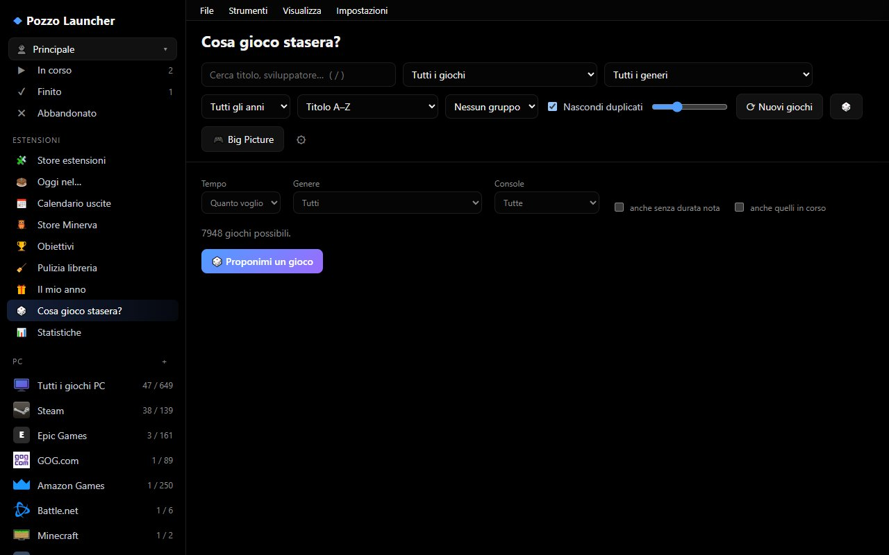

# Guida e Introduzione

Pozzo Launcher è una libreria universale di videogiochi per il PC: raccoglie in un'unica interfaccia elegante e velocissima le **ROM delle console** che hai sul disco e i **giochi PC** di tutti i tuoi store (Steam, Epic Games, GOG, Riot Games, Battle.net, Amazon, Xbox e Minecraft), li completa automaticamente con copertine in alta risoluzione, descrizioni, valutazioni della critica e durate, e li avvia con un semplice clic.


> Il manuale è disponibile anche in formato PDF completo: [PozzoLauncher-manuale.pdf](PozzoLauncher-manuale.pdf), identico al sito web ma organizzato per la stampa o la consultazione offline. Si trova anche tra gli allegati di ogni versione su GitHub.

---

## Cosa vuoi fare oggi? (Percorsi guidati con anteprima)

Seleziona l'obiettivo che desideri raggiungere per visualizzare subito la schermata corrispondente e la guida passo-passo:

### 1. Esplorare la mia collezione e avviare un gioco subito
Cerchi un'interfaccia istantanea, fluida anche con centinaia di migliaia di giochi, con ricerca in tempo reale, filtri per console e schede dettagliate complete di voti e screenshot?

[](libreria.md)

👉 **Cosa fare:** Vai al capitolo [La libreria](libreria.md) per scoprire come organizzare le viste, ordinare per valutazione o durata e personalizzare le copertine.

---

### 2. Non so a cosa giocare stasera!
Hai poco tempo, giochi in compagnia o vuoi un consiglio intelligente basato sui titoli che hai amato di più?

[](libreria.md#per-te-e-a-cosa-vuoi-giocare)

👉 **Cosa fare:** Apri la vista **✨ Per te** nella barra laterale o premi **🎲 A cosa vuoi giocare?**: l'app ti farà 3 semplici domande (tempo a disposizione, giocatori, genere) proponendoti subito i migliori giochi pronti da avviare! Leggi la guida [Per te e consigli](libreria.md#per-te-e-a-cosa-vuoi-giocare).

---

### 3. Usare il telefono come telecomando, controller o schermo touch per DS e 3DS
Vuoi controllare il PC dal divano, usare lo smartphone come joypad con giroscopio per Mario Kart o come touchscreen per Nintendo DS e 3DS?

[](telefono-streaming.md)

👉 **Cosa fare:** Vai in [Telefono e streaming](telefono-streaming.md): bastano 30 secondi per inquadrare il codice QR, senza installare app dagli store, con certificato locale protetto.

---

### 4. Giocare sulla TV dal divano (Modalità Big Picture)
Hai collegato il PC al televisore del salotto e vuoi navigare la libreria esclusivamente tramite controller senza toccare mouse o tastiera?

[](bigpicture.md)

👉 **Cosa fare:** Premi `F11` per entrare in [Big Picture](bigpicture.md): interfaccia a 10 piedi con suoni, navigazione a frecce e schermata home personalizzabile.

---

### 5. Cambiare tema e personalizzare l'esperienza grafica
Preferisci un tema scuro per monitor OLED, un look retrò anni '80 o una disposizione dell'interfaccia a scaffali orizzontali in stile Netflix?

[](ESTENSIONI.md)

👉 **Cosa fare:** Consulta la guida [Temi e profili di esperienza](ESTENSIONI.md) per vedere le anteprime dei 4 temi inclusi (OLED, Notte Blu, Retrò, Chiaro) e dei 6 profili desktop (Scaffali, Cinema, Console, Dashboard, Vetrina, Catalogo).

---

### 6. Giochi gratis del momento, lista desideri e porting PC
Vuoi riscattare i giochi gratuiti settimanali di Epic, Steam, GOG e Prime Gaming, oppure installare le ricompilazioni native per PC dei capolavori console?

[](extra.md)

👉 **Cosa fare:** Leggi la sezione [Giochi gratis, lista desideri e port PC](extra.md) per scoprire come monitorare i prezzi minimi storici e giocare ai porting PC con grafica potenziata.

---

### 7. Ho una domanda o qualcosa non funziona?
Hai dubbi sull'avvio di un emulatore, la sincronizzazione dei salvataggi tra due PC o un errore di rete?

[](assistenza.md)

👉 **Cosa fare:** Consulta il nostro nuovo [Centro Assistenza e Domande Frequenti (FAQ)](assistenza.md) in stile Assistenza Google per trovare risposte immediate e soluzioni guidate a tutti i problemi comuni!

---

### 8. Gestire i download con coda unica, Torrent e servizi Debrid
Vuoi scaricare i tuoi giochi con accelerazione a segmenti paralleli, gestire file torrent o sbloccare link con Real-Debrid ed estrarre automaticamente gli archivi nelle cartelle giuste?

👉 **Cosa fare:** Apri la vista **⬇ Download** nella barra laterale e consulta la guida [Gestore dei download integrato](store-online.md#gestore-dei-download-integrato-coda-torrent-e-debrid) per scoprire le opzioni di coda, la modalità gioco e l'estrazione automatica per Nintendo Switch.

---

### 9. Giocare online con un amico (Netplay RetroArch & Eden Switch)
Vuoi sfidare un amico a distanza ai classici arcade/console su RetroArch o avviare una stanza privata locale/wireless su Nintendo Switch con Eden?

👉 **Cosa fare:** Vai alla sezione [Partita con un amico](giocare.md#partita-con-un-amico): genera un codice invito con un clic, invialo al tuo amico e giocate subito insieme in rete locale, su internet o tramite VPN gratuita.

---

## Panoramica delle funzionalità

| Area | In breve | Dove approfondire |
|---|---|---|
| **Libreria** | Griglia di copertine con ricerca istantanea, filtri, collezioni automatiche e personali, consigli | [La libreria](libreria.md) |
| **ROM e Metadati** | Riconosce le cartelle console, identifica i giochi offline e scarica dati e immagini da molte fonti | [ROM e scraping dei dati](rom-e-scraping.md) |
| **Giocare** | Avvia ogni gioco con l'emulatore giusto, registra il tempo di sessione, copia i salvataggi, disco veloce SSD | [Giocare](giocare.md) |
| **Download Manager** | Coda unificata HTTP a segmenti, Torrent e Debrid (Real-Debrid, ecc.) con estrazione automatica | [Aggiungere store e download](store-online.md#gestore-dei-download-integrato-coda-torrent-e-debrid) |
| **Multiplayer / Netplay** | Gioca a distanza con un amico su RetroArch o Eden Switch con codice invito senza server | [Giocare con un amico](giocare.md#partita-con-un-amico) |
| **Giochi PC** | Giochi installati e posseduti di Steam, Epic, GOG, Riot, Battle.net, Amazon, Xbox | [Giochi PC dagli store](store-pc.md) |
| **Store online** | Cataloghi di giochi da scaricare per console e PC, letti da siti e archivi web | [Aggiungere store](store-online.md) |
| **Extra** | Giochi gratis settimanali, lista desideri con prezzi chiavi, port PC dei giochi console | [Giochi gratis, lista desideri, port PC](extra.md) |
| **Telefono** | Il telefono come telecomando, controller (anche 4 giocatori) e doppio schermo touch DS/3DS | [Telefono e streaming](telefono-streaming.md) |
| **TV** | Interfaccia a schermo intero nativa per controller e schermi 4K | [Big Picture](bigpicture.md) |
| **Personalizzazione** | 4 temi di colore, 6 profili di esperienza desktop e store di estensioni/plugin | [Temi e plugin](ESTENSIONI.md) |
| **Più PC e Famiglia** | Sincronizzazione dati tra due PC in LAN/cartella condivisa e profili utente separati | [Dati e manutenzione](manutenzione.md#sincronizzazione-tra-pc), [Profili](libreria.md#profili-utente) |
| **Integrazioni** | Presenza su Discord (anche netplay 1 di 2), avvisi di Windows, esportazione libreria web | [Giocare](giocare.md#mostrare-su-discord-cosa-stai-giocando), [Avvisi](extra.md#avvisi-di-windows) |
| **Assistenza & FAQ** | Risoluzione problemi passo-passo, autodiagnostica Salute, domande frequenti | [Centro Assistenza e FAQ](assistenza.md) |

---

## Webhook

Impostazioni › Generale › **Webhook**: Pozzo può inviare una richiesta `POST` in JSON a un indirizzo che scegli, quando succede uno di questi eventi: `gioco_avviato`, `gioco_chiuso`, `download_finito`, `prezzo_sceso`. Ogni webhook ha un indirizzo `http://` o `https://`, gli eventi da inviare, un segreto facoltativo e il pulsante **Prova** per verificarlo. Puoi averne fino a 20.

Esempio di corpo inviato (`event` è uno dei quattro nomi sopra, `time` è in UTC, `data` cambia a seconda dell'evento):

```json
{"event": "gioco_avviato", "time": "2026-11-04T20:30:00+00:00", "data": {"...": "stato del gioco, varia in base all'evento"}}
```

Se imposti un segreto, ogni richiesta porta l'intestazione `X-Pozzo-Signature: sha256=<HMAC-SHA256 del corpo>` per verificare che arrivi da Pozzo.

Esempio per Home Assistant: crea un'automazione con trigger **Webhook** (ID, ad esempio `pozzo-gioco`), poi nel webhook di Pozzo usa `http://IP-DI-HOME-ASSISTANT:8123/api/webhook/pozzo-gioco` come indirizzo e seleziona solo gli eventi che ti servono. Il webhook di Home Assistant non richiede segreto.

---

## Architettura e Sicurezza

Pozzo Launcher è composto da un **server locale leggero** (Python, FastAPI) che comunica con un'interfaccia web visualizzata in una finestra nativa di sistema.
- Il server locale risponde esclusivamente sul PC su cui è in esecuzione (`127.0.0.1`).
- La porta viene scelta a caso all'avvio e protetta da un token segreto generato sul tuo PC.
- Il codice è completamente open source e verificabile.
