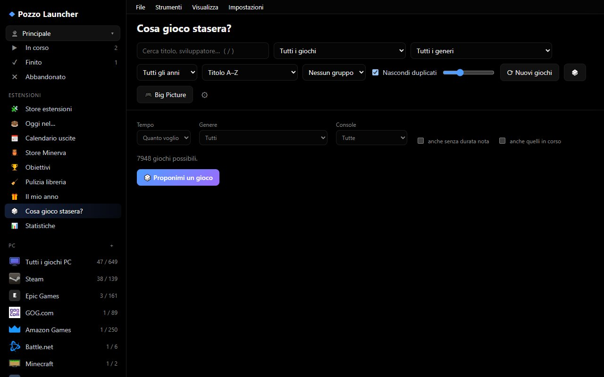

# La libreria

La finestra principale ha tre parti: la **barra laterale** a sinistra (viste, console, store, collezioni), la
**barra degli strumenti** in alto (ricerca, ordinamento, filtri) e la **griglia** delle copertine. Un clic su una
copertina apre il **dettaglio** del gioco sulla destra.

La libreria arriva al programma in un'unica volta: ricerca, filtri e ordinamenti sono calcolati in memoria e sono
istantanei anche con decine di migliaia di giochi. Nella griglia esistono solo le copertine visibili, servite come
miniature WebP leggere.

## Le viste della barra laterale

| Vista | Cosa mostra |
|---|---|
| **✨ Per te** | Pagina di consigli in stile Netflix (vedi [Per te](#per-te-e-a-cosa-vuoi-giocare)) |
| **▦ Tutti i giochi** | Tutta la libreria: ROM e giochi PC |
| **★ Preferiti** | I giochi segnati con la stella; sotto la voce, una **sotto-voce per console** con i preferiti di quella console (compaiono solo quelle che ne hanno) |
| **🛒 Store** | Giochi da installare o scaricare: posseduti negli store ma non installati, e giochi degli store online |
| **👥 Multigiocatore locale** | Giochi con almeno 2 giocatori sullo stesso schermo |
| **🎁 Giochi gratis** | Offerte gratuite del momento (vedi [Giochi gratis](extra.md#giochi-gratis)) |
| **🕹 Port e app** | Giochi console ricompilati per PC e giochi/emulatori dalle release GitHub (vedi [Port e app](extra.md#port-e-app)) |
| **♡ Lista desideri** | Giochi che vuoi comprare, con prezzi e avvisi (vedi [Lista desideri](extra.md#lista-desideri)) |
| **📷 Schermate** | Le schermate fatte durante le partite |
| **🏆 Migliori giochi** | Classifiche Top 100 e Top 1000 (vedi [Migliori giochi](#migliori-giochi)) |
| **📊 Statistiche** | Tempo di gioco per console e store, giochi più giocati, completezza dei dati |
| **◷ Giocati di recente** | In ordine di ultima partita |
| **🧩 Applicazioni** | I programmi aggiunti a mano come *Applicazione* invece che come gioco (compare solo se ce ne sono) |
| **? Senza dati** | Giochi per cui nessuna fonte ha trovato informazioni |
| **⧉ Duplicati** | Le versioni secondarie dei giochi (altre regioni, revisioni) |
| **⊘ Nascosti** | I giochi che hai nascosto |

Sotto le viste ci sono le **console** (con il numero di giochi), la sezione **PC** con i singoli store, le
**collezioni** e le **collezioni intelligenti**. Gli stati dei giochi (Da giocare, In corso, Finito, Abbandonato)
sono viste anch'essi.

Ogni voce della barra laterale è un filtro della stessa griglia: per esempio **👥 Multigiocatore locale** mostra solo
i giochi con almeno due giocatori sullo stesso schermo, con gli stessi filtri e ordinamenti di *Tutti i giochi*.

## Profili utente

Se al PC giocano più persone, ognuna può avere il suo **profilo**: il pulsante **👤** in cima alla barra laterale
mostra il profilo attivo e apre il menu per cambiarlo, crearne uno nuovo (**＋ Nuovo profilo…**), rinominarlo o
eliminarlo.

| Separato per profilo | Comune a tutti i profili |
|---|---|
| Preferiti, nascosti, stati, note e voti | La libreria: ROM, giochi PC, store online, dati scaricati |
| Tempo di gioco, partite, *Giocati di recente* | Emulatori, profili di avvio |
| Collezioni personali e modifiche alle collezioni | Plugin, collezioni intelligenti |
| Lista desideri e le sue chiavi (IsThereAnyDeal, GG.deals) | Schermate |
| Account Spotify, Discord (presenza e voce), RetroAchievements, Epic, GOG, Steam (chiave API e id), token GitHub dei port | Percorsi e cartelle ROM globali, store del sistema (Battle.net, Amazon, Xbox, Riot) |
| Tema ed esperienza (un profilo nuovo parte da quelli già scelti) | |
| Quali giochi si vedono: cartelle ROM proprie, giochi aggiunti a mano, giochi del proprio account negli store | |

Ogni profilo ha un'icona (emoji o parola) e un colore, mostrati nel pulsante 👤: si cambiano dal menu, alla voce
**🎨 Icona, colore e PIN…**. Il **PIN** (4-8 cifre) blocca il profilo nel menu: per passarci, o per cambiarne l'aspetto
e il PIN, bisogna prima inserirlo. Il PIN serve a non cambiare profilo per sbaglio, non protegge i file: chi ha
accesso alla cartella dati vede gli account. Dopo cinque PIN sbagliati si aspetta 30 secondi.

**Dove si cambia utente.** L'utente in uso è sempre in alto a destra, nella barra dei menu (**👤 nome ▾**): un clic apre il menu del profilo con **👥 Cambia utente…**, **＋ Nuovo profilo…** e la modifica di icona, colore e PIN. Lo stesso comando è nel menu **File**, in *Impostazioni → Generale → Profili utente* (**👥 Cambia utente…**), con `Ctrl+P` e, in Big Picture, dalla scheda **Utente**. Vale in ogni grafica, anche quando la barra laterale è nascosta.

Con due o più profili compare all'avvio la schermata **«Chi gioca?»**: si sceglie con mouse, frecce e Invio o con il controller; un profilo con PIN chiede il PIN con un tastierino. Spuntando **«Entra sempre con questo profilo su questo dispositivo»** la schermata non compare più su quel dispositivo (il PC e il telefono si ricordano ciascuno la propria scelta). Per tornare a scegliere a ogni avvio togli la spunta in *Impostazioni → Generale → Profili utente*, oppure la casella dalla stessa schermata; da lì puoi anche disattivare del tutto «Chi gioca?». Un profilo con PIN lo richiede di nuovo a ogni nuovo avvio dell'app, anche se ricordato. La libreria resta una sola per tutti.

### Una libreria sola, ognuno vede i suoi giochi

Metadati, copertine e cache sono **una sola copia per PC**: se due profili hanno lo stesso gioco, ha un solo record e una sola
copertina. Cambia solo *chi lo vede*: le cartelle ROM globali, i giochi installati sul PC e gli store del sistema sono di
tutti; una cartella ROM aggiunta da un profilo (`roms_extra`), i giochi aggiunti a mano da un profilo e i giochi solo
posseduti sul suo account Steam/Epic/GOG sono suoi (se due profili hanno la stessa cartella o lo stesso gioco, lo vedono
entrambi). I giochi aggiunti a mano prima di questa versione restano di tutti. Dopo aver cambiato cartelle o account
si ricostruisce la libreria.

Il profilo è **per dispositivo**: il PC e un altro browser possono avere profili diversi (cookie `gs_profile`). Il telefono
(`/m/`) si abbina con un token, non con il cookie del PC: usa il profilo scelto per ultimo sul server finché non ne sceglie
un altro. Le copie di sicurezza includono anche i file `profiles/*.json: contengono le credenziali degli account.

Il profilo **Principale** c'è sempre e non si elimina. Eliminare un altro profilo non cancella niente: il suo
database e il file con gli account vanno in `cache/profiles/eliminati/` (il file degli account sta nella cartella
delle impostazioni, in `profiles/`). Non si può cambiare profilo durante una partita. Con la
[sincronizzazione tra PC](manutenzione.md#sincronizzazione-tra-pc) ogni profilo si sincronizza con quello che ha lo
**stesso nome** sull'altro PC.

## Cercare, ordinare, raggruppare

- **Ricerca** (tasto `/`): cerca nel titolo, nello sviluppatore, nella console e nello store. Più parole devono
  esserci tutte; accenti e maiuscole non contano.
- **Ordinamento**: Titolo A–Z, Anno ↑/↓, Console, Ultimi giocati, Tempo di gioco, Valutazione, Dimensione ↑/↓,
  Durata ↑/↓ (HowLongToBeat), Store.
- **Raggruppamento**: nessuno, per console, per anno o per lettera, con un'intestazione per ogni gruppo.
- **Filtro installati** (nelle viste di console e store): *Tutti*, *Solo posseduti / installati*,
  *Solo da scaricare / installare*.
- **Nascondi duplicati**: mostra una sola versione per gioco (attivo di default).
- **Dimensione delle copertine**: il cursore accanto ai filtri.
- **🎲 Gioco a caso**: sceglie un gioco tra quelli mostrati (filtri e ricerca compresi), preferendo quelli avviabili
  subito.

### Scopri

Il pannello **Scopri** filtra e ordina la vista corrente per trovare cosa giocare:

| Filtro | Criterio |
|---|---|
| 🏆 Migliori per la critica | voto Metacritic (RAWG) o della critica (IGDB) almeno 75 |
| ❤️ Più amati dal pubblico | voto dei giocatori almeno 75% con almeno 20 voti |
| ⭐ Capolavori | critica almeno 90 oppure pubblico almeno 85% con almeno 50 voti |
| 🔥 Più votati | ordinati per numero di voti dei giocatori |
| 💎 Gemme nascoste | voto alto (almeno 80%) ma pochi voti (da 5 a 200) |
| 🕹 Grandi classici | usciti prima del 2000 con voto almeno 75% |
| 🆕 Usciti negli ultimi 3 anni | |
| 👥 Multigiocatore in locale | almeno 2 giocatori sullo stesso schermo |
| ⏱ Brevi / 🏔 Lunghi | storia principale entro 5 ore / di almeno 40 ore (HowLongToBeat) |
| ⏳ Mai giocati | nessuna partita registrata |
| 👎 Peggio valutati | voto sotto il 50% con almeno 10 voti |
| ❔ Senza valutazione | |

Si combina con un **genere** e un **decennio**. Quando un filtro Scopri decide l'ordine, l'ordinamento normale si
disattiva.

### Console senza giochi: «Altre console»

Le console si vedono **tutte**, anche quelle senza giochi né store: queste stanno nel gruppo ripiegabile **Altre
console**, così puoi aggiungere lo store anche a loro. Aggiungere gli store a una console (dall'editor, da Minerva o da
Link → Store) la popola subito, senza riavviare l'applicazione.

## Il dettaglio di un gioco

Il pannello di dettaglio mostra copertina, sfondo, descrizione, sviluppatore, editore, generi, anno, giocatori,
valutazioni (pubblico e critica), peso, fonti dei dati e, se servono, i dati mancanti. Nella grafica a modale (Cinema) c'è anche la durata HowLongToBeat.

Azioni principali:

- **▶ Gioca** (o `Invio`, o doppio clic sulla copertina) avvia il gioco. Per un gioco PC non installato c'è
  **⬇ Installa**, per un gioco degli store online i pulsanti di download di ogni fonte.
- **★ Preferito**, **Stato** (📋 Da giocare, ▶ In corso, ✔ Finito, ✖ Abbandonato), **Nascondi**.
- **Nota personale** e **voto da 1 a 5 stelle**: valgono per tutte le versioni del gioco.
- **Collezioni**: aggiungi o togli il gioco da una collezione.
- **Versioni**: le altre versioni dello stesso gioco (regioni, revisioni, altri store); puoi scegliere quale usare
  come principale.
- **⚙ Profilo di avvio** (emulatore, argomenti e script solo per questo gioco) e **🖥 Collegamento sul desktop**:
  vedi [Giocare](giocare.md#profilo-di-avvio-di-un-singolo-gioco).
- **Mancano: …** con **⟳ Cerca dati mancanti**: riprova le fonti solo per questo gioco e le sue versioni.
- Sezioni aggiuntive secondo il gioco: salvataggi, RetroAchievements, aggiornamenti e DLC Switch, port PC
  disponibili. Sono descritte nei rispettivi capitoli.

### Menu del tasto destro

Un clic destro su un gioco apre un menu rapido, in tutte le viste (libreria, Per te, Top, statistiche e le grafiche Cinema,
Console, Dashboard, Vetrina e Scaffali): Gioca, Dettagli, Mostra nella cartella, **🖼 Immagini del gioco…**, applicazioni
abbinate, **⬇ Installa** e **🛒 Pagina dello store** (giochi degli store), **🖥 Collegamento sul desktop**, **📋 Copia il
titolo**, preferiti, aggiungi a una collezione, **voto a stelle** (1-5), stato, nascondi. **Rimuovi da…** toglie il gioco dalla vista corrente (per
esempio da «Giocati di recente», che azzera solo l'ultima partita lasciando tempo di gioco e numero di avvii) o dalle
altre categorie a cui appartiene.

### Scegliere l'immagine del gioco

**🖼 Immagini del gioco…** (menu del tasto destro, oppure **🖼 Immagini** nella scheda del gioco) mostra una casella per
ogni tipo di immagine: *Copertina*, *Sfondo*, *Banner*, *Logo*, *Icona*, *Schermata*… Sotto ognuna c'è da dove arriva:
**dalle fonti** (scaricata durante lo scraping) o **scelta da te**. Scelto un tipo puoi:

- **📁 Carica dal PC**: un file PNG, JPG, GIF, WebP o BMP (fino a 25 MB). Puoi anche trascinarlo nella finestra.
- un clic su un candidato di **SteamGridDB**, se l'estensione è attiva e ha la chiave;
- incollare l'**indirizzo di un'immagine** (http o https) e premere **Usa**: l'app la scarica. Serve l'indirizzo
  dell'immagine, non quello della pagina che la contiene. Se il sito la blocca, salvala sul PC e caricala;
- **↺ Torna all'originale**: toglie la tua scelta e rimette l'immagine delle fonti (o nessuna, se le fonti non l'hanno).

Funziona anche per i giochi a cui le fonti non hanno trovato nulla, come Hearthstone su Battle.net.

Con un solo posto da guardare, l'immagine scelta vale ovunque: griglia, scheda, Big Picture, telefono e pagina web
esportata.

### Video snap

Brevi clip di gameplay (da ScreenScraper) partono al passaggio del mouse sulla copertina, nella scheda del gioco, in
Big Picture e nel salvaschermo. Sono **spenti di default**: si attivano in **Impostazioni › Aspetto** con **Scarica
video snap** e si scaricano alla prossima raccolta dei dati (tetto di 30 MB a clip, quindi occupano disco e banda).
Rispettano l'impostazione delle animazioni.

### Clip nella galleria

Nella vista **📷 Schermate** compaiono anche i clip video (`.mp4`, `.webm`, `.mkv`) di Xbox Game Bar, NVIDIA ShadowPlay
e AMD ReLive creati durante la sessione: si importano da soli e si riproducono dalla galleria. I video **non vengono
copiati**: la galleria usa il file originale, quindi se lo sposti o lo cancelli sparisce anche da lì.

### Obiettivi di Steam, GOG ed Epic

Nella scheda del gioco gli obiettivi di Steam, GOG ed Epic compaiono (barra di progresso, icone, bloccati e
sbloccati, rarità) accanto a RetroAchievements. La pagina **Obiettivi sbloccati** mostra i totali per store dei giochi
di cui hai aperto la scheda almeno una volta. Per Steam servono la chiave API e lo SteamID (**Impostazioni › Store ›
Account**, verificati al salvataggio); GOG ed Epic usano l'account già collegato e leggono solo i giochi **installati**.

## Una versione per gioco

Le versioni regionali e le revisioni dello stesso gioco sono **raggruppate** in una sola scheda: Rubino, Ruby, Rubin
e Rubis sono un unico gioco. Il raggruppamento usa il codice prodotto Nintendo (per esempio AGB-**AXV**J), l'identità
IGDB e ScreenScraper. Viene mostrata la versione nella tua lingua, secondo `languages` e `regions` della
configurazione; le altre restano nel dettaglio.

Preferiti, tempo di gioco, stato e collezioni valgono per **tutto il gioco**, cioè per tutte le sue versioni. Lo
stesso vale per un gioco PC presente su più store (per esempio Steam ed Epic): è una scheda sola con più versioni, e
la principale è quella installata. Lo store che avvia il gioco si sceglie in **Impostazioni › Libreria**, con **Unisci i
giochi presenti su più store** e l'elenco degli **store preferiti** in ordine (di default Steam, GOG, Epic); spegnendo
l'opzione ogni store torna una scheda a sé. Il tempo di gioco è la somma delle versioni.

## Collezioni

### Collezioni automatiche

Raccolgono i giochi della stessa saga su tutte le console (Pokémon, Kingdom Hearts, Tomb Raider…). Sono generate dai
franchise di libretro e IGDB più un'euristica sul titolo. Una collezione nasce con almeno 3 giochi
(`[collections] min_games`); `exclude` toglie dei franchise e `aliases` unisce franchise con nomi diversi (vedi
[Riferimento](riferimento.md)).

Puoi **rinominarle**, **nasconderle**, **togliere o aggiungere giochi**. Le modifiche restano anche dopo ogni
ricostruzione della libreria. Le collezioni hanno icona e copertina scaricate da Wikipedia
(**Impostazioni › Fonti › Immagini delle collezioni**).

### Collezioni personali

Si creano con **＋** accanto a *Collezioni* e funzionano come le automatiche, ma le riempi tu.

### Collezioni intelligenti

Con **＋⚡** accanto a *Intelligenti* crei una collezione che si aggiorna da sola in base a regole:

- console e store (nessuna = tutte), generi (almeno uno), stato;
- valutazione minima (%) e voto minimo della critica (/100);
- giocatori in locale (almeno), anno da/fino a;
- durata minima e massima in ore (HowLongToBeat);
- solo giochi pronti da avviare (ROM presente o gioco installato).

## Per te e «A cosa vuoi giocare?»

La vista **✨ Per te** è una pagina di scaffali:

- **▶ Riprendi**: i giochi con stato *In corso*; **Giocati di recente**;
- **📋 Dalla tua lista da giocare**, i più brevi prima;
- **Consigliati per te** e **Perché hai giocato …**: giochi simili a quelli che hai giocato di più;
- **Il meglio di** un genere; **🧩 Continua le tue saghe**, **📚 Collezioni che potrebbero piacerti**,
  **🏆 Le saghe meglio valutate**, **🗂 Le collezioni più grandi**.

Il pulsante **🎲 A cosa vuoi giocare?** fa poche domande (quanto tempo hai, con quante persone giochi, che cosa
cerchi, generi, epoca, dove vuoi giocare, se vuoi qualcosa di nuovo) e propone una dozzina di giochi adatti. Le
risposte sui generi aiutano anche i consigli futuri.

## Migliori giochi

**🏆 Migliori giochi** mostra la classifica globale **Top 100 / Top 1000**; la pagina di ogni console ha
**🏆 Top 100** per quella console. Le classifiche comprendono sia i giochi posseduti sia quelli scaricabili dagli
store online.

- Entrano solo i giochi con **voti affidabili**: almeno 2 fonti, oppure un voto della critica, oppure 50 voti.
- Il punteggio unisce critica (Metacritic/IGDB) e giocatori.
- Nella classifica globale lo stesso gioco su più console conta una volta, preferendo la versione posseduta.
- **↻ Aggiorna voti online** chiede a IGDB e RAWG i voti dei candidati.

## Statistiche

**📊 Statistiche** riassume la tua collezione e il tuo tempo:

- i **totali**: giochi in libreria, giochi giocati almeno una volta, tempo di gioco complessivo (app e store),
  giochi finiti, in corso e da giocare, con le ore che servono per finire il backlog (HowLongToBeat);
- **Il tuo anno**: le ore giocate mese per mese e la classifica dell'anno;
- **Tempo per console e store**, **tempo per genere**, **i più giocati di sempre** e la completezza dei dati.

I numeri arrivano dal tempo di gioco registrato dall'app più quello dichiarato dagli store.

## Valutazioni

Il voto mostrato combina tutte le fonti pesandole per **numero di voti** (media bayesiana): 4,7 con 1.800 voti conta
più di 5,0 con 2 voti. Il voto della **critica** (Metacritic o IGDB) è mostrato a parte.

## Scorciatoie della libreria

| Tasto | Azione |
|---|---|
| `/` | Cerca |
| `Esc` | Chiude il menu, il dettaglio o la ricerca |
| `Invio` | Avvia il gioco aperto nel dettaglio |
| Doppio clic su una copertina | Avvia il gioco |
