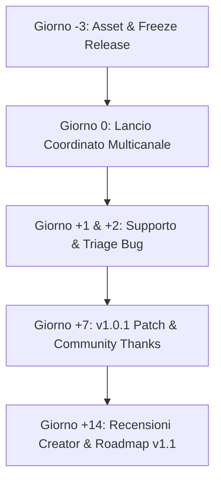

# Pozzo Launcher — Influencer Outreach, Media Pitch & Social Launch Strategy

> Guida operativa, database contatti, template di outreach e piani editoriali per il lancio ufficiale di **Pozzo Launcher**.
> Repository: `https://github.com/erpaffo/Pozzo-Launcher`
> Documentazione: `https://erpaffo.github.io/Pozzo-Launcher/`

---

## 1. Database Target & Outreach Creator / Media

### 1.1 Schede Target Creator & YouTuber Internazionali

| Creator / Canale | Piattaforma & Focus | Canale di Contatto / Business Email | Angolo di Presentazione / Hook Specifico |
| :--- | :--- | :--- | :--- |
| **Retro Game Corps** (Russ) | YouTube / Web (Retrogaming, Handheld, Emulation) | Business Inquiry Form / `contact@retrogamecorps.com` (DM X: `@RetroGameCorps`) | Rispetto per l'accuratezza DAT (No-Intro/Redump), pulizia 1G1R, scraping offline istantaneo, interfaccia elegante pronta all'uso su PC da salotto / handheld. |
| **ETA PRIME** | YouTube (Mini PC, Handheld, Emulation, SBC) | `etaprimechannel@gmail.com` (DM X: `@TheEtaprime`) | Setup in 3 minuti, benchmark velocità su collezioni enormi (50k+ ROM), integrazione fluida con PC Stores (Steam, GOG, Epic) e Big Picture a 60fps su Mini PC. |
| **Joey's Retro Handhelds** | YouTube / Guides (Handhelds, Software Setup) | `joeysretrohandhelds@gmail.com` (Discord / DM X: `@JoeysRetroHH`) | Alternativa snella e moderna a Playnite ed ES-DE per Windows/Linux/Mac. Focus su facilità d'uso per guide "best setup". |
| **Retro Handhelds** (Stubbs, Zu) | YouTube / Podcast / Web | `stubbs@retrohandhelds.gg` / `contact@retrohandhelds.gg` | "What to play tonight", feature mobile controller con giroscopio per testare su display secondari, personalizzazione temi e layout. |
| **The Phawx** | YouTube (Handheld PCs, Steam Deck, ROG Ally) | Inquiries via YouTube About / X `@ThePhawx` | Architettura multipiattaforma (Windows/Linux amd64), zero-bloat, consumi ridotti, supporto gamepad nativo per salotto. |
| **GamingOnLinux** (Liam Dawe) | Sito web / Mastodon / X | `contact@gamingonlinux.com` / Mastodon `@gamingonlinux` | 100% Open source, pacchetto nativo `.deb` e `tar.gz`, zero telemetria, streaming Moonlight/Sunshine integrato. |
| **Boiling Steam** | Web (Linux Gaming, Emulazione) | `contact@boilingsteam.com` | Approccio FOSS, prestazioni dello scraper DAT locale rispetto a scraper lenti basati solo su chiamate web. |

### 1.2 Creator & Portali Italiani (Retrogaming & Tech)

| Nome / Canale | Piattaforma | Canale di Contatto | Angolo di Presentazione |
| :--- | :--- | :--- | :--- |
| **Kenobisboch** (Fabio Bortolotti) | YouTube / Twitch / X | Contatto via social / mail pubblica | Il fascino dell'archivismo e dell'accuratezza dei DAT Redump/No-Intro; focus layout "Retro" e "Shelves" che riproducono la sensazione della collezione fisica. |
| **PlayerInside** (Raiden & Midna) | YouTube / Social | `management@playerinside.it` | Soluzione all-in-one per riunire tutti i giochi PC gratis di Epic, Steam e le vecchie glorie della giovinezza in un'interfaccia TV da salotto. |
| **Multiplayer.it / Everyeye.it** | Web Magazine | `redazione@multiplayer.it` / `redazione@everyeye.it` | "Software Made in Italy": progetto open source italiano che sfida i giganti dell'aggregazione giochi con feature uniche come il controller virtuale da smartphone. |
| **Tom's Hardware Italia** | Web Magazine | `redazione@tomshw.it` | Guida/focus su come trasformare un vecchio PC o Mini PC da salotto in una console definitiva con un launcher moderno e leggero. |
| **RetroVillage / Canali Retro ITA** | YouTube / Community | Mail canale / Community Discord | Facilità di gestione per librerie italiane ed europee, unione versioni regionali e scrap automatico. |

---

### 1.3 Template Email — Primo Contatto Creator (Inglese)

> **Oggetto:** A fresh, lightweight open-source launcher for your retro & PC games (Pozzo Launcher)
>
> **Consiglio:** Inviare la mattina (09:00 - 10:30 nel fuso orario del creator: EST per USA Est, PST per West Coast).

```text
Hi [Creator Name],

Long-time follower of your work — your deep-dive guides on emulation and frontends have been my go-to reference for years.

I’m reaching out because I just released Pozzo Launcher, a free and open-source frontend for Windows, Linux, and macOS that unifies PC stores (Steam, Epic, GOG) and massive retro ROM libraries without the typical clutter or tedious setup.

Here are 3 unique things built into it that I thought you might appreciate:

1. Offline DAT-Powered Scraping: It matches ROMs locally against No-Intro & Redump DATs before touching any API. It scans 10,000+ files in seconds, merges regional duplicates (1G1R), and never hits rate limits.
2. 7 Layouts × 4 Themes Out of the Box: From a console-like Couch Big Picture to sleek Shelves, Cinema, and OLED views — switchable in 1 click without installing third-party skins.
3. Phone as Virtual Controller + Gyro: Scan a local QR code on your phone and you instantly get a touch controller with motion/gyro controls and full library launching — zero app download required.

It’s completely free, GPL licensed, and has zero telemetry.

- 60-Second Video Preview: [Link to Unlisted YouTube / Streamable Video]
- GitHub Repository & Downloads: https://github.com/erpaffo/Pozzo-Launcher
- Online Documentation: https://erpaffo.github.io/Pozzo-Launcher/

No strings attached and no review pressure at all. If you ever have 5 minutes to test it on your setup, I’d love to hear your raw impressions or feedback.

Thanks for your time and for everything you create for the scene,
[Your Name / Nickname]
Lead Developer, Pozzo Launcher
GitHub: @erpaffo | X: @[YourHandle]
```

---

### 1.4 Template Email — Follow-up Creator (Dopo 5-7 Giorni)

> **Oggetto:** Re: A fresh, lightweight open-source launcher for your retro & PC games (Pozzo Launcher)

```text
Hi [Creator Name],

Quick ping in case my previous note got buried in your inbox. 

We just pushed v1.0.1 based on initial community feedback (improved controller hotkeys and faster background artwork caching). 

If you'd like to check out the 60-second clip or grab the portable build:
-> https://github.com/erpaffo/Pozzo-Launcher/releases

Either way, thank you for your time, and keep up the great content!

Best,
[Your Name]
```

---

### 1.5 Pitch per Testate Giornalistiche e Siti Tech/Linux

#### 1.5.1 Pitch per GamingOnLinux & Boiling Steam (Inglese)

> **Oggetto:** Tip / Release: Pozzo Launcher — fast, open-source retro & PC game frontend with offline DAT scraping (Linux native)

```text
Hi [Liam / Boiling Steam Team],

I'm the developer of Pozzo Launcher, a brand-new open-source game launcher and library manager built with Linux gaming and emulation in mind, released under the GPL license.

Why it might interest your readers:
- Native Linux Support: Available as a clean .deb package and standalone tar.gz for 64-bit Linux.
- Offline-First Intelligent Scraping: Uses local No-Intro and Redump checksum databases for near-instant ROM identification and 1G1R regional grouping, only falling back to web APIs for missing metadata.
- Unified PC + Emulation: Aggregates native Linux/Proton games from Steam, GOG, Epic, Heroic alongside classic consoles.
- Couch & Handheld Ready: Includes a full-screen Big Picture controller mode, Moonlight/Sunshine streaming hooks, and a built-in mobile web remote/gyroscope gamepad.
- Strict Privacy: Zero telemetry, no forced account creation, 100% local storage.

The full source code, pre-built binaries, and documentation are available now:
- GitHub: https://github.com/erpaffo/Pozzo-Launcher
- Releases: https://github.com/erpaffo/Pozzo-Launcher/releases/latest
- Manual: https://erpaffo.github.io/Pozzo-Launcher/

Feel free to reach out if you need additional screenshots, technical details, or have any questions.

Cheers,
[Your Name]
Pozzo Launcher Developer
```

#### 1.5.2 Pitch per Multiplayer.it / Tom's Hardware / HDblog (Italiano)

> **Oggetto:** Proposta News / Software Open Source Italiano: Arriva Pozzo Launcher, il frontend universale per retrogaming e PC

```text
Gentile Redazione di [Multiplayer.it / Tom's Hardware / HDblog],

Vi contatto per segnalarvi un progetto open source italiano che potrebbe interessare la vostra community di appassionati di retrogaming e gaming su PC: **Pozzo Launcher**.

Pozzo Launcher nasce per risolvere la frammentazione tra i cataloghi digitali moderni (Steam, Epic Games Store, GOG) e le collezioni di ROM per emulatori, offrendo un'esperienza unificata da scrivania o da salotto.

I punti chiave del progetto:
- Riconoscimento offline ultrarapido: Grazie all'integrazione locale dei DAT No-Intro e Redump, cataloga e unifica le versioni regionali di decine di migliaia di ROM in pochi secondi, senza saturare le API web.
- 7 Layout interscambiabili e 4 Temi: Dal layout "Scaffali" e "Originale" fino al layout "Cinema" e "Big Picture" full-screen studiato per il joypad da divano.
- Controller da smartphone senza installazione: Inquadrando un QR code locale dal cellulare, lo smartphone si trasforma in un telecomando e controller virtuale con giroscopio per interagire con i giochi.
- Made in Italy & 100% FOSS: Gratuito, senza telemetria o account obbligatori, con installer e versioni portatili per Windows, Linux e macOS.

Tutti i dettagli, download e documentazione:
- Repository GitHub: https://github.com/erpaffo/Pozzo-Launcher
- Manuale online in italiano: https://erpaffo.github.io/Pozzo-Launcher/
- Galleria Immagini Stampa / Screenshot HD: [Link cartella Press Kit o docs/img/]

Resto a vostra completa disposizione per interviste, chiarimenti tecnici o approfondimenti.

Cordiali saluti,
[Nome Cognome]
Sviluppatore di Pozzo Launcher
```

---

## 2. Social Media Launch Threads

### 2.1 Thread di Lancio per X / Twitter

*Nota: Ogni tweet deve contenere media (video o screenshot ad alta risoluzione) per massimizzare il click-through rate (CTR).*

#### Tweet 1 (Hook Virale + Video Demo)
> Tired of messy ROM folders and having your PC games scattered across 5 different launchers? 🎮
>
> Meet **Pozzo Launcher**: a lightning-fast, open-source frontend that brings your Steam/GOG/Epic library and retro consoles into one gorgeous, unified dashboard.
>
> Free. No accounts. No tracking.
>
> 🧵👇 [Attach: 30s video showing smooth scrolling across games + layout switch]

#### Tweet 2 (Feature 1: Scraping DAT Offline)
> 1/5 ⚡ **Instant Offline Scraping**
>
> Most launchers take hours querying web APIs. 
> Pozzo matches ROMs locally against No-Intro & Redump DAT databases via CRC in seconds.
>
> Duplicate regional releases are cleanly merged into one entry (1G1R). Zero rate limits.
> [Attach: docs/img/libreria.jpg]

#### Tweet 3 (Feature 2: Layouts & Temi)
> 2/5 🎨 **Your Library, Your Style**
>
> A layout shouldn't just change colors—it changes how you browse:
> ▫️ Catalog & Shelves for retro purists
> ▫️ Cinema & Showcase for box-art lovers
> ▫️ Dashboard & Console for clean vibes
>
> Mix them freely with Light, Midnight Blue, OLED, and Retro themes.
> [Attach: Immagine comparativa a 4 riquadri dei layout]

#### Tweet 4 (Feature 3: Phone Virtual Controller + Gyro)
> 3/5 📱 **Turn your phone into a game controller**
>
> Sitting on the couch without a gamepad? Scan the local QR code from your phone:
>
> ✅ Touch controls with low latency
> ✅ Hardware Gyroscope / Motion controls
> ✅ Launch any game straight from your browser
>
> Zero mobile apps to install.
> [Attach: Breve clip/GIF del controller da smartphone in azione]

#### Tweet 5 (Feature 4: Big Picture + PC Stores)
> 4/5 🛋️ **Couch Big Picture & Store Integration**
>
> Switch to Big Picture with full gamepad navigation.
>
> Automatically pulls in your Steam, Epic Games, GOG, and Amazon libraries. You can even attach companion tools (like Deck Trackers or emulators) that boot automatically with your title.
> [Attach: docs/img/bigpicture.jpg]

#### Tweet 6 (CTA + GitHub Star)
> 5/5 Ready to build your ultimate gaming vault?
>
> Pozzo Launcher is 100% free and open-source for Windows, Linux, and macOS.
>
> 📥 Download & Manual: https://github.com/erpaffo/Pozzo-Launcher
> 📖 Online Guide: https://erpaffo.github.io/Pozzo-Launcher/
>
> If you like the project, drop a star ⭐ on GitHub — it helps immensely!

---

### 2.2 Versione Adattata per Mastodon / Fediverse

*Caratteristiche: enfasi su FOSS, privacy, niente DRM/account proprietari, supporto Linux, pacchettizzazione.*

```text
🎮 Introducing Pozzo Launcher — A fast, modern & open-source frontend for retro and PC gaming.

If you love keeping your game collection organized locally without telemetry or locked ecosystems, this is for you.

✨ Key Highlights:
• Offline-First: Instant ROM matching via No-Intro & Redump DATs + regional deduplication (1G1R).
• Unified Library: Consoles alongside native PC games (Steam, GOG, Epic, custom .exes).
• Fully Customizable: 7 distinct browsing layouts × 4 themes (including true OLED & Retro).
• Sofa Ready: Native Big Picture gamepad mode + a zero-install mobile web controller with gyro support.
• Cross-Platform: Windows, macOS (Apple Silicon), and Linux (.deb / tar.gz).

Built with Python, open-source (GPL), zero ads, zero tracking.

👉 GitHub: https://github.com/erpaffo/Pozzo-Launcher
👉 Docs: https://erpaffo.github.io/Pozzo-Launcher/

#LinuxGaming #GamingOnLinux #FOSS #OpenSource #Emulation #RetroGaming #Python #IndieDev
```

---

### 2.3 Versione Adattata per Bluesky

*Caratteristiche: tono diretto, visivo, conciso (limite 300 caratteri per post, formato thread a 3 post).*

#### Post 1
> Say hello to Pozzo Launcher 🎮
>
> A brand new, open-source game launcher that merges your retro ROMs and PC stores (Steam/GOG/Epic) into one lightning-fast library.
>
> 7 layouts, Big Picture mode, offline DAT scraping, and zero telemetry.
>
> 🔗 https://github.com/erpaffo/Pozzo-Launcher

#### Post 2
> 💡 What makes it special:
> • Scans 10,000+ ROMs in seconds using offline No-Intro/Redump DATs.
> • Merges US/EU/JP versions cleanly.
> • Turn any phone into a wireless controller with gyro via local QR code.
> • Available for Linux, Windows & macOS.

#### Post 3
> Grab the latest release or inspect the code on GitHub:
> 🔗 https://github.com/erpaffo/Pozzo-Launcher/releases
>
> If you're building a couch gaming rig or retro handheld setup, give it a spin! ⭐ Stars on GitHub are always appreciated!

---

### 2.4 Versione Adattata per Threads / Instagram Reel Caption

```text
Stanco di avere giochi sparsi tra Steam, Epic, GOG e cartelle di ROM introvabili? 🕹️

Abbiamo creato Pozzo Launcher, un frontend universale open source, leggero e ultra veloce:
⚡ Scansione istantanea offline con database DAT No-Intro e Redump
🎨 7 layout intercambiabili (Scaffali, Vetrina, Cinema, Dashboard...)
🛋️ Modalità Big Picture per giocare dal divano con joypad
📱 Usa il tuo smartphone come controller touch con giroscopio senza installare alcuna app!

100% gratuito, zero pubblicità, zero tracciamento.
Disponibile per Windows, Mac e Linux.

Link al progetto e download gratuito in bio / sul nostro GitHub: erpaffo/Pozzo-Launcher 🚀

#retrogaming #pcgaming #opensource #setupgaming #gamingitalia #emulazione #steamdeck
```

---

## 3. Calendario e Checklist di Lancio (Timeline a 14 Giorni)



---

### Giorno -3: Preparazione Asset & Verifica Tecnica

- [ ] **Tag & Release GitHub:**
  - Creare il tag `v1.0.0` e verificare che la CI compili correttamente tutti gli asset (`.exe` setup, `.zip` portatile, `.dmg`, `.deb`, `.tar.gz`).
- [ ] **Test di Installazione Pulita (Clean VM / Sandbox):**
  - Test su Windows 11 fresco (verificare messaggio SmartScreen e istruzioni per bypassarlo).
  - Test su Ubuntu/Debian (`sudo apt install ./pozzo_amd64.deb`).
  - Test su macOS (controllo avviso Gatekeeper e click destro -> Apri).
- [ ] **Asset Visivi & Media Kit:**
  - Registrare 3 clip brevi (1080p60 o 4K):
    1. Scansione cartella ROM rapida + visualizzazione libreria compilata.
    2. Cambio fluido tra i 7 layout e 4 temi.
    3. Controller smartphone: inquadratura QR, impugnatura telefono, movimento del giroscopio.
  - Caricare il video completo (60-90 secondi) su YouTube in modalità **Non in elenco** (Unlisted).
  - Predisporre cartella Google Drive / GitHub Releases con screenshot full-res per la stampa.
- [ ] **Verifica Documentazione:**
  - Controllare che il sito MkDocs (`https://erpaffo.github.io/Pozzo-Launcher/`) sia aggiornato e privo di link rotti.

---

### Giorno 0: Il Giorno del Lancio (Ordine Cronologico di Esecuzione)

Per massimizzare il picco di traffico e l'algoritmo di GitHub Trending / Reddit, seguire questo ordine orario (orari riferiti a **CET / Ora Italiana**, corrispondenti a mattina presto / prima mattinata EST negli USA):

| Orario (CET) | Canale / Piattaforma | Azione Specifica |
| :--- | :--- | :--- |
| **12:00** | **GitHub Release** | Pubblicare ufficialmente da *Draft* a *Latest Release* con release notes formattate e screenshot. |
| **12:15** | **YouTube** | Convertire il video trailer da *Non in elenco* a *Pubblico* con link a GitHub in prima riga della descrizione e commento pinnato. |
| **12:30** | **Reddit** (`r/emulation`) | Post text dettagliato: architettura dello scraping DAT offline, unificazione 1G1R, zero-telemetria, link al repo. *(Seguire rigorosamente la Rule 1 di r/emulation: niente link a ROM o copyright assets)*. |
| **13:00** | **Reddit** (`r/linux_gaming`, `r/SteamDeck`) | Post orientato su Linux: pacchetto `.deb`, compatibilità controller, modalità Big Picture per living room e handheld. |
| **13:30** | **Hacker News (Show HN)** | `Show HN: Pozzo Launcher – Fast, offline DAT-powered game launcher for retro and PC`. |
| **14:00** | **X / Twitter** | Pubblicare il Thread di lancio da 6 tweet con video agganciato al Tweet 1. |
| **14:15** | **Mastodon & Bluesky** | Pubblicare i post adattati per il fediverse e bluesky con tag rilevanti. |
| **14:30** | **Outreach Creator (Batch 1)** | Invio delle prime 10-15 email personalizzate a Retro Game Corps, ETA PRIME, Joey, The Phawx (usando Template 1.3). |
| **15:00** | **News Linux & Tech Press** | Invio dei pitch email a GamingOnLinux, Boiling Steam e testate italiane (usando Template 1.5). |
| **16:00 - 23:00** | **Reddit & Community Monitor** | Presidio attivo su Reddit, Hacker News e X per rispondere a ogni singolo commento entro 15 minuti. |

---

### Giorno +1 e +2: Interazione e Triage Critico

- [ ] **Triage dei Bug Report:**
  - Monitorare la sezione *GitHub Issues* e le menzioni social.
  - Applicare subito label standard (`bug`, `enhancement`, `question`, `needs-reproduction`).
  - Se emerge un blocco critico (es. crash con specifici controller Bluetooth o percorsi cartella con caratteri speciali), creare un hotfix branch immediato.
- [ ] **Presidio Commenti:**
  - Ringraziare calorosamente chi lascia feedback costruttivo o suggerisce layout.
  - Non essere difensivi sui confronti (es. vs Playnite o ES-DE): evidenziare i trade-off (Pozzo è multipiattaforma nativo, usa DAT offline, ha controller web incorporato).
- [ ] **Preparazione Hotfix v1.0.1:**
  - Se necessario, rilasciare una patch rapida per i 3 bug più segnalati dalla community nelle prime 48 ore.

---

### Giorno +7: Il Ciclo di Consolidamento ("Community Feedback Update")

- [ ] **Rilascio Update v1.0.1 / v1.0.2:**
  - Pubblicare il changelog intitolato: *"Pozzo Launcher v1.0.1 — Thanks to our amazing community!"*.
  - Ringraziare esplicitamente nei credits gli utenti che hanno aperto issue o PR.
- [ ] **Email di Follow-up Creator:**
  - Inviare il Template di Follow-up (Sezione 1.4) ai creator che non hanno ancora aperto l'email iniziale.
- [ ] **Social Update Post (X / Mastodon / Bluesky):**
  - "1 week of Pozzo Launcher: over [X] downloads and [Y] stars! Here is what we just fixed and added based on your requests: [Screenshot/GIF del changelog]".
- [ ] **Pianificazione Feature Roadmap:**
  - Aggiornare i GitHub Projects / Milestones con le feature votate dalla community (es. nuovi emulatori supportati, estensioni, traduzioni comunitarie).

---

### Giorno +14: Analisi Metriche & Copertura Stampa

- [ ] **Review delle Metriche:**
  - Conteggio GitHub Stars e Fork.
  - Numero di download unici per piattaforma (Windows vs Linux vs macOS).
  - Traffico referral da Reddit, GamingOnLinux, YouTube.
- [ ] **Ringraziamenti Creator:**
  - Se un canale YouTube o blog pubblica un video/articolo, ricondividere con clip e quote su X, Bluesky e subreddit dedicati ringraziando pubblicamente il creator.
- [ ] **Apertura Nuove Traduzioni (Crowdsourcing):**
  - Se la community internazionale risponde positivamente, lanciare una call per tradurre l'interfaccia e il manuale in spagnolo, francese, tedesco e giapponese.
